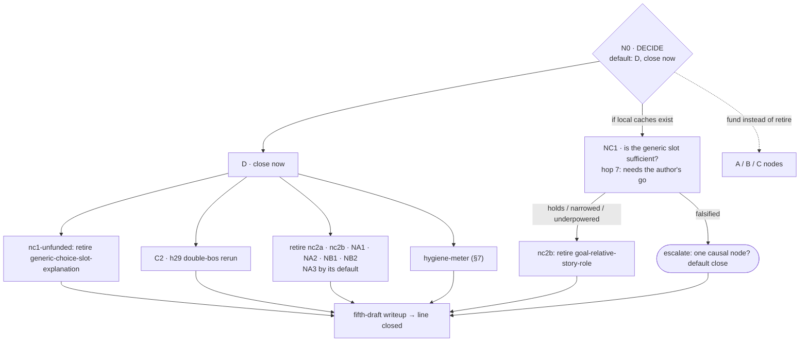
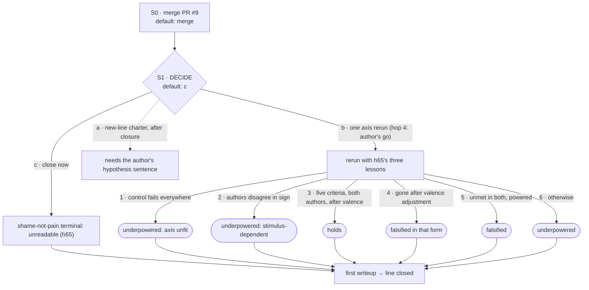

# Program v2: what this repository is doing, how each line ends, and what each result triggers

*Status: **proposal, v0.3**. Two reviews have been folded in. The first was an adversarial review
([`program_v2/review_1.md`](program_v2/review_1.md)); the second was a verification pass, summarised
in §10. Claude drafted the document in a cloud session on 2026-10-15 at the author's request.*

***Paraphrase under non-negotiable 7.*** *The author asked for a formal writeup of what we are
doing: short-, medium- and long-term goals, careful success criteria, and a decision tree of
hypotheses with a planned response to each possible finding. His reason, paraphrased, was that the
work chases its tail too often. His own words are in that session's conversation, not in a commit.*

*Nothing below is decided. Items marked **DECIDE** belong to the author.*
- *Accepting the document must be a commit signed with the author's registered key (rule D). Step
  zero is therefore registering a key (§6, #1).*
- *Each decision has a **default** and a **date**. Defaults take effect only after acceptance. A
  date then reads as the later of the date shown and acceptance + 14 days.*
- *An unaccepted plan funds nothing and defaults nothing. A plan an agent wrote cannot bring itself
  into force through the author's silence.*

*Evidence base: three read-only audits by agents in the same session, kept verbatim in
[`program_v2/`](program_v2/), plus the reviews. Every quote used here was re-checked against the
file it cites (§9). File line numbers are at `2a992c3`, the `main` this was written against.*

---

## 0. Diagnosis

Each unit of work here is rigorous on its own terms: it is pre-registered, carries arms and floors,
and has a gate. The tail-chasing happens one level up:
1. a gate fails and leaves a caveat;
2. the caveat motivates the next pre-registration;
3. that next unit is rigorous too;
4. nothing at the level of the chain says when to stop.

When a decision is needed, it goes to the author with no default, and the work routes around the
wait. **The repository has stopping rules for experiments, and none for chains or decisions.**

| pattern | evidence |
|---|---|
| **Chains with no end state** | **Narrative after h50:** 23 experiments. By the audit's judgment, about 4–5 aim at the line's question, 10 answer the previous experiment's caveat, 4 calibrate a readout and 4 are behavioural prerequisites. They form four chains, none with a declared end ([`narrative_audit.md`](program_v2/narrative_audit.md) §3–4). **Shame-axis h55–h61:** the audit counts 9 of 18 units as caveat-chasing. Most ran on grids that hour 62 then deprecated: "They are not to be extended, and no new result may be drawn from them" (`research/shame-axis/prompts/DEPRECATED.md:12-13`). |
| **Failed gates turned into new "holds" rows** | `late-reveal-paired-margin-shifts` and `story-period-margin-shift` are holds rows split off registered decisions that failed (`narrative_audit.md` §5). |
| **Decisions handed to the author with no default** | "That decision is the user's and the program waits on it" (`research/narrative/docs/EXPERIMENTS.md:2095`). No decision was ever recorded. About 683k tokens went into h48–h50 after the stall, and then v1 was dropped without a word. From 2026-09-23 to 2026-10-15, about three weeks, nothing was committed, and PR #9 stayed open. |
| **A conditional reframing that fired and was read narrowly** | h62b pre-registered: "If treatment sits inside the random band, the pain axis is a correlate of this behaviour, not a cause, and **the line is a behavioural study** — stated now so it cannot be softened afterwards" (`v0_correction_shape_prereg.md:89-91`). The condition fired (`v0_steering_results.md:3-8`). The sentence is scoped to "this behaviour", the opener ritual. Hour 64 then named the shame-versus-pain stimuli "the test that could" (`crossmodel_result.md:88-89`). Both readings are defensible; neither was recorded as a decision. |
| **The stated question froze while the working question moved** | The narrative README's question has not changed since 2026-09-21. The work after h50 asks a different question, whether the state at the answer is a story role or an answer slot. That question is written down only in notes. |
| **The closure meter overstates** | Shame-axis reads 20/21 terminal. Yet README question 4 has no row of its own, and `QUESTIONS.md` holds 28 items with no status. In the narrative line, writeup standing claims 3, 5, 6, 7, 9, 10 and 11, and the human-written grid, have no rows. |
| **A claim's meaning changed under a fixed id** | `fixed-plan-circumstance-transfer` was recorded falsified (`13793be`, 23:20), then reworded to a weaker claim and marked narrowed under the same id (`5c7ea84`). That erased a falsified pre-registration. |
| **Tokens stopped being recorded** | No token costs appear after h50; NDIF job counts and some wall times are recorded. Phases 0–2 of v1 alone recorded at least 2.2M tokens, against 1.7M budgeted for all five phases. Phase 1 overran 2.6× and phase 2 4.6×. |
| **A conjecture filed as a finding** | Open problem 4i carried an untested mechanism sentence ("partly a norm ranking") for a month. When tested on 2026-10-15, it was wrong. All 25 rows ran at one seed, and 21 of them shared identical permutations ([`permutation_seed_audit.md`](../research/narrative/notes/permutation_seed_audit.md), on PR #12's branch until it merges). |
| **Process layers decay** | All three Claude Code hooks are broken or bypassed. CI runs only the claims validator. `DELEGATION.md`'s four-question screen was never built. Six of ten merged PRs were merged within 86 s of opening. |
| **A cross-line invalidation that never crossed** | The double-`<bos>` audit marks the narrative h29 generation rerun as affected, "audit owned by the narrative line" (`double_bos_audit.md:28`). The code confirms it (C2). `generation-recomposition` still reads `holds`. |

**One tension I'm leaving standing.** This repository has answered every failure with a new layer of
process, and most layers decayed. This document is one more. In its defence:
- its rules are few;
- two of them are computed from data by `scripts/check_nodes.py`;
- every decision has a default, so nothing can stall;
- §8 lists the conditions under which this document has failed.

But unless C3 is applied, no script runs in CI. That is the decay this document is most exposed to.

---

## 1. What the repository is for

### Long term: the products
1. **Each line closes.** No claim is left non-terminal. Then a final writeup, in which every number
   links to a claims row or a committed artifact.
2. **The measurement core stands as an artifact** (v1's product 1). From a clean checkout with no
   caches, §1A reproduction and §1B rediscovery run and report passes and refusals separately. The
   core's tests run in CI on every pull request. C3 and C6 only begin this.
3. **Whether either line becomes something external** (§6, #16).
4. **No new line is chartered while an existing line is open.** A charter states its question, end
   state, kill condition, budget and root node, and its question is committed in the author's own
   words.

### Medium term: the next six weeks of sessions
- **Decision-complete lines.** Every open claim in both lines is either attached to a funded node or
  terminal.
- **Writeups.** Both are drafted: the narrative fifth draft and the shame-axis first.
- **Narrative closure.** The narrative line closes, under the recommended option D at N0.

### Short term: the next one to three sessions
- **Acceptance.** Register a signing key, then accept, amend or reject this document.
- **Open PRs.** Decide on PR #9 and PR #12.
- **The meter.** Make it honest (`hygiene-meter` nodes, §7).
- **Hooks.** Fix or delete the three hooks. They are config, so the author applies the fix or
  approves an agent doing it.

---

## 2. Rules: five, plus D, and where each is checked

**R1. Work happens at nodes, and nodes are data.**
- **Where nodes live.** Each line keeps `research/<line>/nodes.yaml`; shared items go in
  `docs/nodes.yaml`.
- **What `scripts/check_nodes.py` checks** (the schema is in its docstring):
  - every claim id named in a node exists in the line's `claims.yaml`;
  - once the document is accepted, every open claim sits under a live node;
  - every test names what prompted it, as `note:line`.
- **Every unit names its node.** That covers each pre-registration, run and analysis.
- **New nodes.** A node not in the accepted tree needs an author decision (rule D). *Not yet
  enforced in code: diffing node ids against the accepted commit.*
- **Built on this branch:**
  - the script, with 26 tests in `tests/lsx/test_check_nodes.py`;
  - the trees of §3–§5, encoded as data. Every node is `proposed`, except `c1-permutation-arm`,
    which is `done` and marked `retrospective`.

  Running `python scripts/check_nodes.py` already reports NC1 at hop 7 and S1-b at hop 4, each
  needing the author's go.

**R2. A node fixes its responses before its data.**
- **What the outcome table covers.** Every result, including a failed gate, an underpowered run, and
  arms off their nulls.
- **What each result maps to.** One of five responses:
  - *continue* to a named child, which must in turn name this node as its parent;
  - *narrow*;
  - *falsify*;
  - *retire*;
  - *escalate*, which carries a default (R4).
- **Failed decisions.** A component split off a failed registered decision goes into the parent
  claim's evidence. It never becomes a new holds row unless it was a registered secondary.
- **Timing.** The table is committed before the first activation is read. The commit time is the
  only witness, so that commit must not be rewritten.

**R3. A chain gets three hops, computed from data.**
- **How hop depth is computed.** It is the depth along `parent` links (a root is hop 1), plus one
  per unit listed in `chain_from.experiments`, the earlier chain that the node continues. A hop
  count is never stated as a number.
- **At hop 3,** the outcome table states the chain's end and cannot continue.
- **At hop 4 or beyond,** a test cannot be funded without an author decision (rule D).
- **When the cap stops a chain,** every holds row the chain produced while a named confound of that
  row remained untested is downgraded to `narrowed`, and the confound is named.
- **Confound tests.** A node that only tests a named confound of a standing holds row, such as C2,
  counts against budget but not against the cap.

**R4. Nothing lapses through silence.**
- **Every decision, retirement and escalation carries a default and a date.**
- **A default never spends.** It is one of: retire; close; do not fund; leave as is; or integrate
  work already finished. For a decision, the default is the text of one of the node's own terminal
  outcomes, and `check_nodes.py` enforces that.
- **After acceptance,** a default whose date passes without a decision executes, and is recorded as
  "defaulted, no decision".
- **Escalation dates** count from the commit of the result that raised them. *Not yet in code: the
  checker reports only the decision dates that have passed.*

**R5. The meter counts what the line asks, and budgets are metered.**
- **Rows.** Every README question and every claim the writeup stands on has a row.
- **Meaning changes.** A change of meaning gets a new id, and the old id keeps its original wording
  and status. `claims_v1.md:62-63` should be amended to say so (proposed, not applied). A CI check
  that diffs each id's `claim:` text against `main` belongs in C3.
- **Conjectures.** A mechanism sentence attached to an open defect is labelled *conjecture* until
  it is tested.
- **Budgets** are in NDIF jobs and wall hours, which are metered; tokens are estimated.
  `check_nodes.py` fails any node past 1.5× its metered budget that has not stopped.

**Rule D: what counts as an author decision.** A commit signed with the author's personal key,
whose fingerprint is in `docs/AUTHOR_KEY`, itself committed under that key. `check_nodes.py` verifies
this with `git log --format=%G?/%GF/%cn`. These do **not** count:
- **A commit whose committer is GitHub.** Web-flow signatures verify, but agents can produce them.
- **A GitHub comment.** Agents post under the author's account, sometimes without a footer.
- **An agent's paraphrase, ever.** That includes the "WAIVED by the user" line
  (`EXPERIMENTS.md:1687`) and "per Mykola's explicit instruction"
  (`action_interaction_prereg.md:30-31`).

**What survives unchanged:**
- every non-negotiable in `CLAUDE.md`;
- `DELEGATION.md`'s plan → review → execute → screen → integrate flow;
- v1's standing rules on retractions (a retraction pauses the work), on stating what was not tested,
  and on planner review;
- the claims rules.

**What changes:**
- **The four-question screen,** never built, becomes a checklist at the end of every result note:
  - any number without a named control;
  - any control close to its treatment;
  - a missing required section;
  - no failures mentioned.
- **v1's "one agent at a time"** becomes: concurrent agents only in separate worktrees, never in a
  shared checkout, and never two on one NDIF queue. The first adversarial review had its checkout
  switched under it by the agent writing this document.
- **v1's phase gates** are replaced by R2 and R3.

---

## 3. Shared core and method

| node | question | outcome table | budget |
|---|---|---|---|
| **C1** `c1-permutation-arm` | 4i: is the h8 permutation arm biased? | **Answered in PR #12 (unmerged): withdrawn.** • On 19 Qwen2.5-1.5B rows re-extracted live, the arm's mean over 64 seeds is +0.002, against −0.106 at seed 0. Seed 0 is the most extreme of the 64. • On the 9-combination grids, seed 0's shuffles carry about 3.5 SD of excess true-label overlap on the composed arm (2.3 SD on era; 2.9 on voice and theme). • No row is refused at 256 draws. **Not tested:** h48's six rows on other models (inferred from the committed numbers), and the random arm, which also shares its directions. **Merge** (`c1-merge-pr12`): merge, and decide whether to apply the in-place `EXPERIMENTS.md` retraction (its text is in the note). | done; wall ≈ 0.9 h, CPU |
| **C1a** `c1a-seeding` | **DECIDE:** seeding policy | **(a)** Keep seed 0, so ledger rows reproduce bit-for-bit, and require any statistic pooled across rows to draw independent seeds. **(b)** Per-row seeds from `hashlib.sha256(grid\|model\|layer)` (not Python's `hash()`, which changes per process), with the 15 Qwen ledger rows re-landed. *Default:* (a). | (b): about 2 wall h, CPU |
| **C2** `c2-h29-double-bos` | Does the double-`<bos>` bug change h29's generation numbers? | **Premise confirmed from code.** At hour 47 (`a9d34bc`), `asserted_remote_generate` passed chat-rendered text, already carrying `<bos>`, to nnsight's `generate`, which added another. The fix commit says so ("generate let nnsight add one", `e2a3774`). **Test:** re-run h29's three arms on Gemma-2-9B-it through the fixed path. • *Scoring:* primary scoring uses only (item, target era) pairs whose no-patch, shift and random generations all returned. Each arm's loss is reported on all items; h47 lost 0% of no-patch, 24% of shift and 22% of random. • *Recorded values:* shift (treatment) 0.8364, random 0.1429, no-patch 0.1111. Each arm gets a Wilson 95% interval at its paired n. **Outcomes:** • fewer than 24 paired items → *unreadable*; escalate. *Default:* narrowed ("integrity rerun unreadable"). • no-patch inside its interval around 0.1111, random inside no-patch's, and the treatment interval overlapping or wholly above 0.8364 → **holds**, with refreshed evidence. • treatment's upper bound below 0.8364, but its interval still clear of random's → **narrowed**, with the new number. • treatment interval overlapping random's → **withdrawn**. Escalate: writeup claims 8–10 rest on that 0.84 (`WRITEUP.md:63-81`). *Procedure:* if no-patch or random sits off its null, re-declare the nulls from this run's no-patch arm, record that, then apply the branches. **Feasibility:** `rerun_h29.py` loads the cached stack unconditionally at startup (`rerun_h29.py:136-137`). Without the local cache it needs a reviewed stack-first change. | ≤ 250 NDIF jobs with the cache, ≤ 290 without (36 stack + 30 re-read jobs); ≤ 8 wall h |
| **C3** `c3-ci-and-hooks` | Core tests in CI; fix or delete the hooks | **Infrastructure:** • a `pull_request` workflow running full pytest on CPU torch, `check_claims.py`, `check_nodes.py` and the claim-text diff (R5); • replace `test_check_claims.py:105`'s `term < n` tripwire with a check that a line reporting closed has no live node; • the hook patches in §7. **Success:** at least 380 tests collected and passed, skips listed by name (`-rs`), and any new skip fails the job. **DECIDE.** *Default:* leave. | 2 wall h |
| **C4** `c4-phase2-gate` | **DECIDE:** v1's phase-2 gate | `phase2_v1.md` §4 gives three options: raise the budget, amend the gate to allow NOT-DERIVED with a named blocker, or cut the writeup. Its own recommendation is "(b), then (a) for `crosstalk` alone". *Default:* amend, with NOT-DERIVED marked in both `WRITEUP.md` and the ledger, and no `crosstalk` build. v1 then closes. | — |
| **C5** `c5-doc-sweep` | Documentation sweep | **Mechanical only:** • dead `RESULTS.md` and `docs/ALGEBRA.md` links; • one instrument count, pointing at `INSTRUMENTS.md` (whose header says "Seven" and then calls the eighth "a seventh"); • the README test count; • stale spec statuses; • the phase-3 grid, moved out of the shame-axis directory. **DECIDE:** authorize changes to links and counts only, never to a status or wording. *Default:* not authorized. | 3 wall h |
| **C6** `c6-credentials`, `c6-core-paths` | Shared-core hygiene | • The core hard-codes narrative paths (`checks.py:680`, `ledger.py:43`, `reproduce.py:42-44`). • `reproduce.py` has no `__main__`. • Root `results/calibration/` holds six orphaned copies. • **Credentials:** v1 0.3's waiver reopens on "a shared environment" (`EXPERIMENTS.md:1688-1691`). The machine now hosts two agents, and keys load from `~/.bashrc`. **DECIDE:** re-close via the proxy, or record a new waiver in your own words. *Default:* recorded open, with a dated risk note. | paths: 2 wall h |

---

## 4. Narrative

**What stands, condensed** (`research/narrative/claims.yaml`):
- **Roles.** Role identity is a direction, and the role lens transfers.
- **Factors.** Era clears its measured lexical floor on every factor grid; voice and tense do not.
  Era fails the stricter shallow-layer floor on GPT-J.
- **Generation.** A 3× re-imposed era shift moves generated text (pending C2).
- **Propp.** A Propp-function signal transfers across held-out tales, above controls for text,
  position and layer 0.
- **Answer slot.** On Gemma-2-9B-it, the state at the decision point carries a task-general
  answer-slot code. Patched into 64 two-person property prompts, it shifts the answer by +1.126
  nats.
- **Story-period state.** Single-token transplants of the story-period state shift the answer
  mainly through a listed-plan slot.
- **The original framing.** The "shared relational shape" the line set out to find is mostly slot
  position.

### N0 — DECIDE: what is this line answering, and does it close? (`n0-scope`)

Three programs coexist in one claims table:
- **A.** Factors, and where composition stops (v1's claim).
- **B.** Relational shape, then operator, then transfer. This is the stated question, and the README
  already marks it "Answered: mostly no".
- **C.** Story role versus answer slot, the de facto question since h50.

The options:
- **D. Close now (recommended).**
  - Run C2.
  - Retire through `nc2a-retire-exhausted`, `nc2b-goal-relative`, `na1-depth-sweep`,
    `na2-mood-voice`, `nb1-token-clouds` and `nb2-paraphrase`.
  - **Retire `generic-choice-slot-explanation`** through `nc1-unfunded`, with the reason
    "sufficiency test not funded under D". The reopen trigger is NC1 as specified.
  - Settle NA3 by its default, add the missing rows (`hygiene-meter`), and record chain C's
    closure.
  - Write the fifth draft. It states the stated question's answer as it stands: mostly slot
    position, a partial operator, and factor directions that compose, with era the one that
    survives its floor.
  - Budget: C2's NDIF jobs, plus about 9 wall h for hygiene and the writeup.
- **D + NC1.** As D, with NC1 in place of `nc1-unfunded`. **Recommended if the local Gemma caches
  still exist**, because NC1 then runs offline.
- **A / B / C.** Fund that program's nodes instead of retiring them.

*Default:* D.

#### NC1 — Is a generic answer-slot direction sufficient to explain route transfer? (`nc1-slot-sufficiency`)

- **Statistic.** T(·) is the pilot's registered statistic
  (`goal_route_activation_pilot_prereg.md:44-55`): the held-out cosine against seven-domain
  opposite-telling directions, averaged over blocks 16 and 24.
  - T₀ is T on the unprojected `I_first` vectors: +0.0854 (`goal_route_activation_pilot_result.md:31`).
  - T_proj is T after removing, at each block b, the component along p_b from every `I_first`
    vector (fitted and held-out alike) before unit-normalisation.
  - p_b is the unit direction fitted at block b on all eight `choice_slot_replication` property
    domains, both tellings, using no route state.
  - ρ = T_proj / T₀.
  - All six captured blocks are reported; none is selected.
- **Gate 0.** |T₀ − 0.0854| ≤ 0.0005, recomputed with the pilot's corrected analysis code. On
  re-extraction, the pilot's repeat-drift gate (prereg:81-83) must also pass. If either fails:
  stop and escalate; *default:* close, retiring the claim as "pilot did not reproduce".
- **Nulls.**
  1. The pilot's exact 2⁸ world-label orientation null (prereg:56-59), recomputed on the projected
     vectors. "Inside" means T_proj ≤ its q95.
  2. 64 cosine-matched directions, each projected out exactly as p_b is:
     r_i = c_b·u_b + √(1−c_b²)·z_i, where
     - u_b is the unit mean of all eight domains' unit `I_first` vectors at block b;
     - c_b = cos(p_b, u_b);
     - z_i is uniform on the unit sphere orthogonal to u_b (seeds 0–63).

     This null exists because a random direction with near-zero cosine removes almost nothing.
     That is why v0.1's table was inverted.
- **CI and δ.**
  - ρ's 95% CI comes from the pilot's 10,000-draw domain bootstrap, resampling domains jointly for
    T_proj and T₀.
  - δ is the smallest true ρ whose CI excludes 0 with probability 0.8. It is simulated from the
    pilot's domain-level scores and committed before any projection.
  - If δ ≥ 0.5, NC1 does not run, because it is underpowered by design. Escalate; *default:* close.
- **Outcomes,** mutually exclusive, first match wins:
  - ρ_hi < δ **and** T_proj < the q05 of the cosine-matched residuals → **holds**;
  - ρ_lo > δ **and** T_proj > the orientation null's q95 → **falsified**, and escalate: fund one
    causal node? *Default:* close;
  - ρ_lo ≤ 0 **and** ρ_hi ≥ δ → **underpowered**;
  - otherwise → **narrowed**, recording ρ, its CI and the cosine-matched comparison.
- **Scope.** The eight domains were chosen after earlier positives. A result generalises only to
  them.
- **Budget.** Offline if the local caches exist. Otherwise 528 NDIF jobs (264 route and 264
  property activations), ≤ 6 wall h.
- **Chain position.** NC1 is hop 7. Chain B's six experiments came first (#12, #13, #14, #15, #17,
  #19), so it needs the author's go. It closes chain B, unless the author funds a causal node at
  the falsified branch.

#### NC2 — Retire the exhausted claims (DECIDE; default: retire)

| node · claim | reason on record | reopen trigger |
|---|---|---|
| `nc2b` · `goal-relative-story-role` (decided by NC1's result if NC1 runs) | Five designs tried to separate goal-relative role from binding, clause order or answer slot at the activation level, and none succeeded: audit rows #5, #6, #7, #16 and #20/#22 (`narrative_audit.md` §3). The final-token readout is a task-general slot (`choice_slot_replication_result.md:66-68`). At the two story-ending positions tested there is no shared route direction (`prequestion_route_state_result.md:86-91`), and that note calls the result location-specific. | A planner-reviewed design that can, in principle, separate role from slot |
| `nc2a` · `fixed-plan-behavioral-capacity` | Its own registered rule: "If none passes, record the calibration failure and do not use this base model's name-completion accuracy as a story-understanding measure" (`elicitor_calibration_prereg.md:22-24`). | none |
| `nc2a` · `fixed-plan-goal-reversal-capacity` | Three control batteries never produced a full pass: V3 failed (28/32), V4 was abandoned at 9/32 after a review found a shortcut, and V5 stopped after 3 failures in 15 (`goal_reversal_calibration_result.md:28-32`). A frozen shortcut rule reaches 21/24, so even a full pass would barely clear it. That makes it **underpowered, not impossible**. The behaviour it targeted is shown by `goal-route-cross-behavior`, which holds. | A control battery that passes in full |
| `nc2a` · `propp-full-story-context` | Exploratory: +0.049 [−0.005, +0.126] on the only annotated corpus, 15 tales. | The result's own next test, a held-wording manipulation within a story (`propp_spike_result.md:76-79`), or a second annotated corpus |

**Chain C closes by record.** "A new domain and model are needed before generalizing this
component" (`firsthop_doubleflip_result.md:23`) is the chain's end state under D. No further
single-token edits are made, and `firsthop-winning-slot-cancellation` stands as scoped.

#### Cluster A

- **NA1 `na1-depth-sweep`** (DECIDE). *Default:* retire, with the reason "the generation boundary is
  reported as measured, on two models".
  - *If funded,* it needs a new spec, with a planner and a review, because piece 2 of
    `scale_vs_tuning_v1.md` fixes `--layer 26` and has no layer sweep (`:344-346`).
  - That spec adds generation sweeps to piece 2's steps 1–2, covering both era *and* theme. The
    theme arm is what distinguishes outcomes A and B (`PROGRAM.md:114-115`).
  - It grades outcomes A–E (`scale_vs_tuning_v1.md:283-316`), plus depth-fraction holds or
    falsified, with numeric thresholds.
  - It budgets NDIF jobs as layers × models × arms × 72, and includes the 70B direction stacks,
    which are not cached.
- **NA2 `na2-mood-voice`: retire on scope.** It serves neither product, has no spec or grid, and its
  stimuli would cost 100–300k tokens. (v0.1's reason, "voice fails its floor", did not follow: hour
  48 calls voice "a readout at its ceiling, not a readout failing".)
- **NA3 `na3-human-grid`.** v1 calls a human-written grid "the cheapest single change to the repo's
  credibility" (`PROGRAM.md:99-100`). The template has sat at 0 of 18 cells since 2026-09-18.
  - *Options:* the author's time; a human-written public corpus instead (the line already uses
    ProppLearner's tales); or retire.
  - *Default:* retire, with the limitation stated in the writeup. Add the row either way.

#### Cluster B

- **NB1 `nb1-token-clouds`** (DECIDE). *Default:* retire, with the reason "not funded under D".
  - *If funded:*
    - **The statistic** is a fixed layer-mean.
    - **Holds** iff (role recovery − slot-position baseline) has a CI excluding 0 *and* recovery
      exceeds the permutation null's q95.
    - **Falsified** only if that CI's upper bound is below a δ computed in advance.
    - **Otherwise** underpowered.
    - **The grid** must vary slot position across domains, and POT (Python Optimal Transport) must
      be installed.
  - **Disclosure:** Claude said in-session that it finds this experiment the most interesting. The
    v0.1 recommendation to fund it was struck on review.
- **NB2 `nb2-paraphrase`** (DECIDE). *Default:* retire. *If kept,* fund it only if NB1 is falsified
  or underpowered. The easier readout, which assumes correspondence, at higher n is the fallback,
  not the follow-up.

---

## 5. Shame-axis

**What stands, condensed:**
- **Replication.** The paper replicates exactly (h51, h53).
- **Self/other.** The network's addition over the lexical floor is the self/other boundary, and that
  boundary is not specific to the pain axis (h64).
- **Correction behaviour.**
  - A false attribution adds nothing beyond the shape of a correction (h62a, r2).
  - A third-party frame licenses dispute (h56, r2).
  - The pain direction does not drive the ritual (h62b).
- **Hour 65** (PR #9, unmerged):
  - "the S2 pain axis fails its positive control in all four models", and passes only at later
    layers in three of them;
  - the Claude-written set's shame effect is lexical;
  - the two authors' sets disagree in sign on Llama.

### S0 — DECIDE: merge PR #9 (`s0-merge-pr9`; default: merge)

PR #9 is the registered test of the line's last open claim, and its analysis code was reviewed
before it ran. Its body reports, as a labelled paraphrase, that the author delegated the clause
writing to two agents. **Ask:** confirm or correct that in your own words (rule D).

### S1 — DECIDE: what happens after hour 65? (`s1-after-h65`; default: S1-c)

- **S1-c (recommended): close now.** Hour 65 found three things:
  - the answer depends on who wrote the stimuli;
  - the rewording floor is as large as the effect;
  - the axis picks out the paper's own pain items only at layers the screen does not use.

  So a rerun is likely to come back unreadable. Make `shame-not-pain` terminal under decision #13's
  status, with the reason "registered test unreadable at the screen layer (h65);
  stimulus-dependent". Then add the missing rows and write the line up.
- **S1-b (`s1b-axis-rerun`): one rerun on the axis, then stop whichever way it comes out.**
  - **Chain position.** It is hop 4, counted from h53 (h53 → h64 → h65 → this), so it needs the
    author's go.
  - **Changes from h65,** which are h65's own three lessons:
    1. choose the layer from the positive-control curve **on other data**, for example the paper's
       A2–A5 and B–E items;
    2. ban failure-valenced words, or balance them across arms;
    3. match vocabulary without a template.
  - **Committed before data:** h65's five effect criteria and a power estimate.
  - **Procedure:** evaluate only the models whose positive control passes; the rest are reported
    unreadable.
  - **Outcomes,** first match wins:
    1. control fails in every model → **underpowered** ("axis unfit");
    2. the author sets disagree in sign in any evaluated model → **underpowered**
       ("stimulus-dependent");
    3. all five criteria met in both sets in every evaluated model, and still met after valence
       adjustment → **holds**;
    4. gone after valence adjustment in either set → **falsified in that form**;
    5. unmet in both sets, with at least 80% power for h65's effect size → **falsified**;
    6. otherwise → **underpowered**.
  - **Budget:** about 400 NDIF jobs (h65's 200 items × the two Llama models, batch size 1) plus
    local Gemma runs; ≤ 6 wall h.
- **S1-a (moved, not recommended).** Re-posing question 3 behaviourally would change its meaning
  under a fixed number. It would also be a new hypothesis that Claude built for a line it was
  proposing to close. If the author wants it, it becomes **a new line's charter, opened only after
  this line closes** (§1, item 4). That charter needs:
  - the hypothesis in one sentence, committed in the author's own words (the shame wording has no
    provenance entry anywhere);
  - a positive control;
  - a shuffled-condition null and a noise floor;
  - branches for one author's set positive and the other null, and for reversed signs;
  - an honest note that "two authors" means Claude and a GPT agent, which reduces the authorship
    confound but does not remove it.

**One tension I'm leaving standing.** S1-c closes the line without a test that could carry its
namesake hypothesis. That is the honest outcome of three results, not a verdict on the hypothesis.

---

## 6. Decisions for the author

Defaults take effect only after acceptance. Each date then reads as the later of the date shown and
acceptance + 14 days. Every default is one of the node's own terminal outcomes (R4).

| # | decision | node | options | recommended | default (2026-10-29) |
|---|---|---|---|---|---|
| 1 | **Register a signing key**, then accept this document | `d15-rule-d-key` | key + accept / amend / reject | key, then accept with amendments | no key yet: the document cannot be accepted, so nothing runs |
| 2 | PR #12 (4i) and its `EXPERIMENTS.md` retraction | `c1-merge-pr12` | merge / merge and apply / close | merge and apply | merge; the retraction stays proposed |
| 3 | PR #9 (hour 65) | `s0-merge-pr9` | merge with confirmation / merge / close | merge, confirming the delegation in your words | merge |
| 4 | N0: narrative | `n0-scope` | D / D+NC1 / A / B / C | D+NC1 if the caches exist, else D | D |
| 5 | S1: shame-axis | `s1-after-h65` | c / b / a as a charter | c | c |
| 6 | Retirements | `nc1-unfunded`, `nc2a`, `nc2b`, `na1`, `na2`, `nb1`, `nb2` | retire / fund | retire | retire |
| 7 | Human-written grid | `na3-human-grid` | your time / a public corpus / retire | your call | retire, stating the limitation |
| 8 | Seeding | `c1a-seeding` | (a) / (b) | (a) | (a) |
| 9 | v1's phase-2 gate | `c4-phase2-gate` | raise / amend / amend + crosstalk / cut | amend | amend, no crosstalk |
| 10 | Documentation sweep | `c5-doc-sweep` | authorize / don't | authorize, links and counts only | not authorized |
| 11 | CI and hooks | `c3-ci-and-hooks` | apply / approve an agent / leave | approve | leave |
| 12 | Credentials and the 0.3 waiver | `c6-credentials` | re-close / new waiver / risk note | re-close | recorded open, with a dated risk note |
| 13 | How measured-but-inconclusive claims end | `d13-statuses` | amend `retired` / a new `underpowered` status | either | amend `claims_v1.md:28` to "abandoned deliberately, reason on record" |
| 14 | `conscription-hypothesis` row status | `s14-conscription-row` | narrowed / falsified | narrowed | narrowed |
| 15 | Strengthen "done" (§1) in CLAUDE.md | `d16-done-definition` | yes / no | yes | no; rows are added under R5 anyway |
| 16 | External product | `d17-external` | yes / no | after both writeups exist | no |

---

## 7. Hygiene (`hygiene-meter`)

**Mechanical.** An agent may do these once the document is accepted; line documents also need C5.
- **Add rows,** each terminal with evidence or attached to a node:
  - the narrative writeup's standing claims 3, 5, 6, 7, 9, 10 and 11;
  - the human-written grid;
  - hour 56's pre-registered primary `enact − true`, which came out reversed (−3.98; r2 −3.13), so
    it is **falsified**;
  - README question 4's own row (#14).
- **Re-id the three claims whose meaning changed:** `fixed-plan-circumstance-transfer`,
  `story-fact-token-causal-edit` and `prequestion-route-interaction`. The old id gets its original
  wording and status back, so a falsified pre-registration stays falsified, and the new id carries
  the rewording.
- **Triage the shame-axis `QUESTIONS.md`.** Each of the 28 items becomes answered, superseded, a
  row, or retired. Any new row needs a node or a terminal status.
- **Model revisions** go in provenance sidecar files, never in post-hoc edits to committed results.
- **Label as paraphrases** the attributions to the author that have no committed source:
  - `overnight_2026-09-22.md:47`
  - shame-axis `QUESTIONS.md:88`
  - `reveal_order_prereg.md:10-11`
  - `action_interaction_prereg.md:30-31`
  - `selfmed_perturbation_confound.md:3`
  - `conscription_direction.md:211-213`
  - `CONSCRIPTION_INSTRUCTIONS.md:8, :25`
  - `crossmodel_result.md:86`
  - `EXPERIMENTS.md:1687`

**Inferred, not verified.** Commits such as `13793be` and `5c7ea84` carry the author's name in the
author field and no agent trailer, but read as agent prose. Agents should commit under their own
identity from now on. For decisions, rule D makes the question moot.

**Needing the author:**
- the README and WRITEUP status edits:
  - shame-axis README questions 2–4;
  - narrative README questions 2–3, which conflict with `relation-lens: falsified` and
    `factors-compose: withdrawn`;
- the `claims_v1.md` amendments for re-ids (R5) and statuses (#13).

**Hooks, proposed and not applied (C3):**
- **SessionStart:** replace the `awk … RESULTS.md` command, which prints only a header, with
  `cd "$CLAUDE_PROJECT_DIR" && python3 scripts/check_claims.py 2>&1 | head -15 && python3 scripts/check_nodes.py 2>&1 | head -15`.
- **PostToolUse:** change both `tests/test_invariants` strings to `tests/lsx/test_invariants.py`.
  As things stand, the invariants never run.
- **PreToolUse merge hook:** delete it. It fires only on a local `git merge` of agent branches, and
  integration now happens through PRs. C3's required `pull_request` job replaces it.

---

## 8. Conditions under which this document has failed

Count from acceptance. After five units of work, v2 **has failed** if any of these holds:
1. open claims across both lines have not decreased;
2. a DECIDE passed its date with neither a decision nor an executed default;
3. a node ran past 1.5× its NDIF or wall budget without stopping;
4. a row was opened by a node descended from a closed chain;
5. a unit ran with no `nodes.yaml` entry.

If it has failed, delete or rewrite this document; do not amend it with a sixth rule.
`check_nodes.py` computes condition 3 for nodes that record `spent`. Conditions 1, 2, 4 and 5 are
checked by hand at each review against this section. Unless C3 is applied, no script runs in CI.

---

## 9. Provenance and what was checked

- **The author's request** is a paraphrase; see the header.
- **The appendices** in [`program_v2/`](program_v2/) are agent-written and committed verbatim:
  - the three audits: `narrative_audit.md`, `shame_axis_audit.md`, `method_audit.md`;
  - `review_1.md` and `review_2.md`.

  Their tallies are their authors' own arithmetic.
- **Re-checked against the files before use.** Line numbers are at `2a992c3`. On this branch
  `docs/PROGRAM.md` gains three header lines, so its references shift by +3.
  - `research/narrative/docs/EXPERIMENTS.md`: `:1687-1691`, `:2093-2095`, `:2174-2176`
  - `docs/PROGRAM.md`: `:20-26`, `:96-120`
  - `docs/specs/phase2_v1.md:95`; `docs/specs/scale_vs_tuning_v1.md:336-352`
  - narrative notes:
    - `propp_spike_result.md:74-80`
    - `goal_route_activation_pilot_prereg.md:31-34`
    - `goal_route_activation_pilot_result.md:31`
    - `goal_reversal_calibration_result.md:26-32`
    - `prequestion_route_state_result.md:86-92`
    - `choice_slot_replication_result.md:66-68`
    - `firsthop_doubleflip_result.md:23`
    - `elicitor_calibration_prereg.md:22-24`
    - `answer_slot_patch_result.md:88-92`
    - `action_interaction_prereg.md:30-31`
  - commits `13793be`, `5c7ea84`, `a9d34bc` (`remote.py` at h47) and `e2a3774`
  - `rerun_h29.py:136-137`
  - `research/narrative/WRITEUP.md:63-81`
  - shame-axis notes:
    - `v0_correction_shape_prereg.md:87-91`
    - `v0_steering_results.md:3-9`
    - `DEPRECATED.md:7-15`
    - `crossmodel_result.md:38-41`, `:86-92`
    - `overnight_2026-09-22.md:47-53`
    - `QUESTIONS.md:61-64`
    - `double_bos_audit.md:26-33`
  - `tests/lsx/test_check_claims.py:98-105`; `docs/specs/claims_v1.md:28`
  - PR #9's body, and its result and pre-registration on `shame-pain-stimuli`
- **Not checked:** whether the local machine's ignored caches still exist. NC1 and C2 need them.

---

## 10. What the two reviews changed

**Review 1** ([`review_1.md`](program_v2/review_1.md), adversarial, on v0.1) recommended
rejection. v0.2 took nearly all of it:
- defaults with dates, and nodes as data;
- NC1 rewritten, because its table had been inverted;
- a close-now option at N0; S1-c recommended; S1-a moved to a charter;
- NA1 requires a spec, and NB2's gating is reversed;
- C2 gets intervals, a loss gate and an off-null branch;
- NN7 labels, and budgets in metered units;
- the rules that survive, listed explicitly;
- re-ids that keep the old wording, and `conscription-hypothesis` turned into a decision;
- C3's success criterion, corrected NC2 reasons, and NA2 retired on scope;
- the omissions and every factual nit.

v0.2 modified two of the review's proposals: R3's downgrade, and rule D's mechanism.

**Review 2** ([`review_2.md`](program_v2/review_2.md)) was a verification of v0.2. It found five blocking problems, all fixed in v0.3:
- **B1.** The default path could not close the narrative line. Fixed with `nc1-unfunded`.
- **B2.** NC1's "holds" could fire with about 70% of the transfer remaining, and it overlapped
  "underpowered". NC1 now has power-bounded, mutually exclusive branches, an exact null, a defined
  p_b, and a gate 0 that can actually be tested.
- **B3.** Rule D's GitHub route could be forged, because agents post as the author. Rule D now
  accepts signed commits only.
- **B4.** §8 overclaimed what the validator computes. It now says which checks are code and which
  are by hand.
- **B5.** Hops could be declared or reset. `chain_from` now lists units, and children must point
  back to their parent. Both are tested.

Its should-fix items were also taken up:
- one hop convention: NC1 is at hop 7 and S1-b at hop 4, both needing the author's go;
- defaults due only after acceptance;
- every default a terminal outcome;
- C2's gap, scoring and budget;
- NC2 split in two;
- a node for every §6 row and for hygiene;
- S1-b's table put in order;
- #13's default no longer misuses `retired`;
- the checker's crash paths and false passes, now covered by tests;
- the header quote, the factual mismatches, metered budgets, and the nits.

**Still open after v0.3, deliberately not chased:**
- the code does not yet enforce that a node added after acceptance needs the author;
- escalation dates are not computed from result commits;
- conditions 1, 2, 4 and 5 of §8 are checked by hand.

**This review chain stops here.** Applying R3 to this document's own making: the reviews were hops
1 and 2, and v0.3 is the declared end state. The next change to this document comes from the
author, not from a third review.
