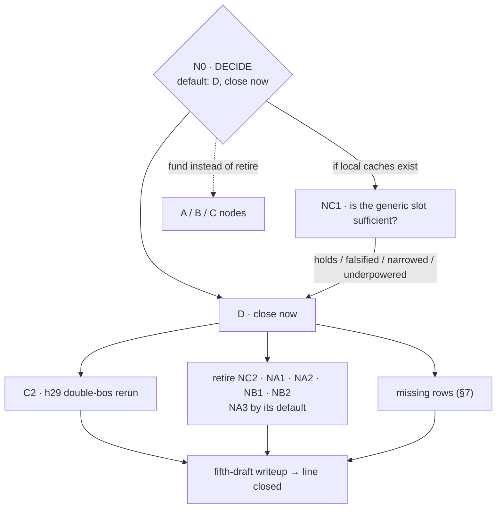
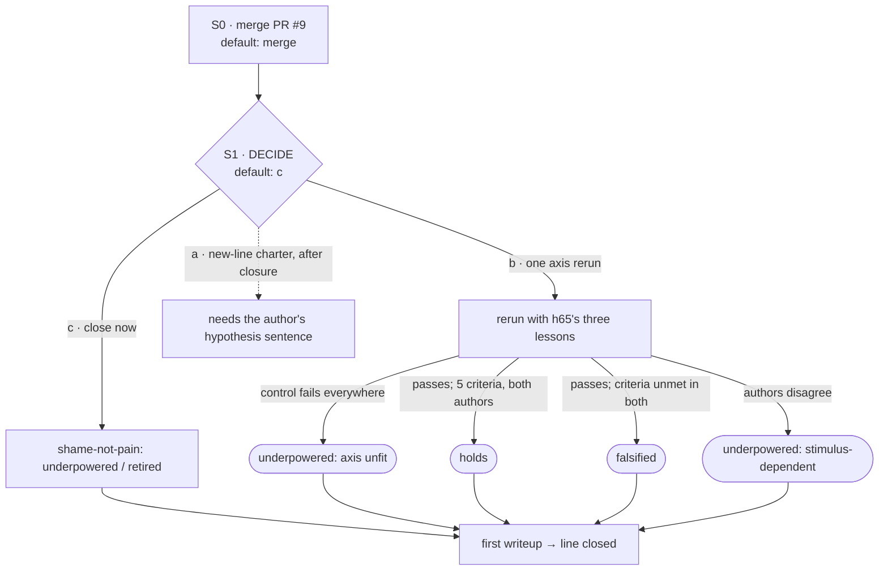

# Program v2: what this repository is doing, how each line ends, and what each result triggers

*Status: **proposal, v0.2**, revised after an adversarial review
([`program_v2/review_1.md`](program_v2/review_1.md); §10 says what changed). Claude drafted it in a
cloud session on 2026-10-15 at the author's request. **Paraphrase under non-negotiable 7:** the
author asked for a formal writeup of what we are doing, with short, medium and long-term goals,
careful success criteria, and a decision tree of hypotheses with planned responses to each finding,
because "we chase our tail too often". His words are in that session's conversation, not in a
commit.*

*Nothing below is decided. Items marked **DECIDE** belong to the author. Each one has a **default**
and a **date** (§6). If the author has not decided by the date, the default executes and is
recorded as "defaulted, no decision". There is one exception: **accepting this document has no
default**. A plan written by an agent cannot bring itself into force by the author's silence.*

*Evidence base: three read-only audits by agents in the same session, kept verbatim under
[`program_v2/`](program_v2/), plus the review. Every quote used here was re-checked against the file
it cites (§9).*

---

## 0. Diagnosis

Each unit of work here is rigorous on its own terms: it is pre-registered, it carries arms and
floors, and it has a gate. The tail-chasing happens one level up:

1. A gate fails and leaves a caveat.
2. The caveat becomes the motivation for the next pre-registration.
3. That next unit is rigorous too.
4. Nothing at the level of the chain says when to stop.

When a decision is needed, it goes to the author with no default, and the work routes around the
wait. **This repository has stopping rules for experiments, but none for chains and none for
decisions.**

| pattern | evidence |
|---|---|
| **Chains with no end state** | **Narrative, after h50:** 23 experiments. The audit judges that about 4–5 aim at the line's question, 10 answer the previous experiment's caveat, 4 calibrate a readout, and 4 are behavioural prerequisites. They form four chains, and none declared an end ([`narrative_audit.md`](program_v2/narrative_audit.md) §3–4). **Shame-axis, h55–h61:** the audit counts 9 of 18 units as caveat-chasing, mostly on grids that hour 62 then deprecated: "They are not to be extended, and no new result may be drawn from them" (`research/shame-axis/prompts/DEPRECATED.md:12-13`). |
| **Failed gates turned into new "holds" rows** | `late-reveal-paired-margin-shifts` and `story-period-margin-shift` are holds rows split off registered decisions that failed (`narrative_audit.md` §5). |
| **Decisions handed to the author with no default** | "That decision is the user's and the program waits on it" (`research/narrative/docs/EXPERIMENTS.md:2095`). No decision is recorded. About 683k tokens were spent after the stall (h48–h50), and then v1 was dropped without a word. The repository then sat idle for 22 days, with PR #9 open since 2026-09-23. |
| **A conditional reframing that fired and was read narrowly** | h62b pre-registered this: "If treatment sits inside the random band, the pain axis is a correlate of this behaviour, not a cause, and **the line is a behavioural study** — stated now so it cannot be softened afterwards" (`v0_correction_shape_prereg.md:89-91`). The condition fired (`v0_steering_results.md:3-8`). The sentence is scoped to "this behaviour", the opener ritual, and hour 64 later named the shame-versus-pain stimuli "the test that could" (`crossmodel_result.md:88-89`). Both readings are defensible. Neither was recorded as a decision. |
| **The stated question froze while the working question moved** | The narrative README's question is unchanged since 2026-09-21. The work after h50 asks a different question: is the state at the answer a story role, or an answer slot? That question is written only in notes. |
| **The closure meter overstates** | Shame-axis reads 20/21 terminal. But README question 4 has no row of its own, and `QUESTIONS.md` holds 28 items with no status. In the narrative line, writeup standing claims 3, 5, 6, 7, 9, 10 and 11 and the human-written grid have no rows. |
| **A claim's meaning changed under a fixed id** | `fixed-plan-circumstance-transfer` was recorded as falsified (`13793be`, 23:20). It was then reworded to a weaker claim and marked narrowed under the same id (`5c7ea84`), which erased a falsified pre-registration. |
| **Tokens stopped being recorded** | No token costs appear after h50. NDIF job counts and some wall times are recorded. Phases 0–2 of v1 alone recorded at least 2.2M tokens, against 1.7M budgeted for all five phases (overruns of 2.6× and 4.6×). |
| **A conjecture filed as a finding** | Open problem 4i carried an untested mechanism sentence ("partly a norm ranking") for a month. When tested on 2026-10-15 it was wrong. All 25 rows ran at one seed, and 21 of them shared identical permutations (PR #12, [`permutation_seed_audit.md`](../research/narrative/notes/permutation_seed_audit.md)). |
| **Process layers decay** | All three Claude Code hooks are broken or bypassed. CI runs only the claims validator. The four-question screen in `DELEGATION.md` was never built. Six of ten merged PRs were merged within 86 seconds of opening. |
| **A cross-line invalidation was never carried over** | The double-`<bos>` audit marks the narrative h29 generation rerun as affected, "audit owned by the narrative line" (`double_bos_audit.md:28`). The code confirms it (C2). `generation-recomposition` still reads `holds`. |

**The tension I'm leaving standing.** This repository has answered every failure with a new layer of
process, and most of those layers decayed. This document is one more layer. So its rules are few
and machine-checked wherever possible (R1 and R3 run from data, not prose), they come with defaults
so they cannot stall, and §8 gives the document conditions under which it has failed.

---

## 1. What the repository is for

### Long term: the products

1. **Each line closes.** No claim is left non-terminal. Then a final writeup, in which every number
   links to a claims row or a committed artifact. **DECIDE:** strengthen CLAUDE.md's definition of
   done so that every README question and every claim the writeup stands on must have a row.
   *Default (2026-10-29):* yes.
2. **The measurement core stands as an artifact** (v1's product 1). From a clean checkout with no
   caches, §1A reproduction and §1B rediscovery run and report passes and refusals separately, and
   the core's tests run in CI on every pull request. This has no funded node yet (C3 and C6 only
   start it).
3. **DECIDE: does either line become something external,** such as a preprint or a post? The site
   already deploys from `claims.yaml`. *Default:* not before both writeups exist.
4. **No new line is chartered while an existing line is open.** A charter states its question,
   end state, kill condition, budget and root node, and its question is committed in the author's
   own words.

### Medium term: the next six weeks of sessions

- **Both lines become decision-complete:** every open claim is either attached to a funded node or
  terminal.
- **Both writeups are drafted:** the narrative line's fifth draft and the shame-axis line's first.
- **Close the narrative line.** Under the recommended option D at N0, it can close within this
  window.

### Short term: the next one to three sessions

- **Accept, amend or reject this document.**
- **Settle PR #9 and PR #12:** merge each or close it.
- **Make the meter honest** (§7, mechanical part).
- **Fix or delete the three hooks.** They are config, so the author applies the fix or approves it.

---

## 2. Rules: five, and where each one is checked

**R1. Work happens at nodes, and nodes are data.**
- **The node file.** Each line keeps `research/<line>/nodes.yaml`, one entry per node, with these
  fields: `id`, `claims` (ids), `parent`, `motivated_by` (`note:line`), `budget` (NDIF jobs and
  wall hours), `spent`, `outcomes` (each result → response), `default`, `decide_by` and `status`.
- **How it is checked.** `scripts/check_nodes.py` validates the file:
  - every claim id must exist in that line's `claims.yaml`;
  - every open claim must sit under a node or be terminal;
  - hop depth is **computed** from the `parent` links, never declared.
- **Who adds nodes.** A node that is not in the accepted tree needs an author decision (rule D).
- **Every unit names its node.** A pre-registration, run or analysis gives the node it executes.
- **Already built, on this branch:**
  - `scripts/check_nodes.py`, with 13 tests in `tests/lsx/test_check_nodes.py`;
  - the trees in §3–§5, encoded as `research/narrative/nodes.yaml`, `research/shame-axis/nodes.yaml`
    and `docs/nodes.yaml` (shared infrastructure). Every node is `proposed`, and `accepted` is
    null.

  Run `python scripts/check_nodes.py`. It already reports NC1 at hop 6, needing the author's go.

**R2. A node fixes its responses before its data.**
- **What the outcome table must cover:** every result, including "a gate failed", "underpowered"
  and "arms off their nulls".
- **What each result maps to:** *continue* (to a named child), *narrow*, *falsify*, *retire*, or
  *escalate*. An escalation has a default, under R4.
- **Splitting a failed decision.** A component split off a failed registered decision goes into the
  parent claim's evidence. It is never filed as a new holds row, unless it was a registered
  secondary.
- **When the table is fixed.** It is committed before the first activation is read. The git commit
  time is the only witness, so that commit must not be rewritten.

**R3. A chain gets three hops, counted from data.**
- **How hops are counted.** `check_nodes.py` computes each node's hop from its parent chain.
- **At hop 3,** the outcome table must state the chain's end state.
- **A fourth hop** needs an author decision (rule D).
- **A chain stopped by the cap** downgrades to `narrowed` every holds row it produced while a named
  confound of that row remained untested, and names the confound.
- **Testing a standing positive.** A node that only tests a named confound of a standing holds row,
  like C2, counts against budget but not against the cap. Integrity work must not be starved by the
  rule against tail-chasing.

**R4. Nothing lapses through silence.**
- **Every DECIDE, escalation and fourth-hop request carries a default and a date.** The default is
  always the cheapest terminal option: retire, close or do not fund. It is never "fund" or
  "continue".
- **If the date passes without a decision,** the default executes and is recorded as "defaulted,
  no decision".
- **The exception:** accepting this document has no default.

**R5. The meter counts what the line asks, and budgets are metered.**
- **Rows.** Every README question and every claim the writeup stands on has a row.
- **Ids.** A change of meaning gets a new id, and the old id keeps its original wording and status.
  `claims_v1.md:62-63` is amended to say so. A CI check compares each id's `claim:` text against
  `main` and fails on any change that does not come with a new id.
- **Conjectures.** A mechanism sentence attached to an open defect is labelled *conjecture* until it
  has been tested.
- **Budgets** are stated in NDIF jobs and wall hours, which are metered. Tokens are estimated. A
  node that reaches **1.5×** either metered budget stops and escalates.

**Rule D: what counts as an author decision.** An author decision is the author's own text:
- a commit signed with his key, which agents in containers do not hold (`git verify-commit`
  checks it);
- or a GitHub comment or review he wrote, without the agent footer.

Agents never write decision records, and an agent's paraphrase never satisfies rule D. That covers
the earlier precedents: the "WAIVED by the user" line (`EXPERIMENTS.md:1687`) and "per Mykola's
explicit instruction" (`action_interaction_prereg.md:30-31`).

**DECIDE:** set up commit signing, or accept the GitHub-comment route alone. *Default:* the
GitHub-comment route alone.

**What survives unchanged.** All of the following stay in force:
- every non-negotiable in `CLAUDE.md`;
- the plan → review → execute → screen → integrate flow in `DELEGATION.md`;
- v1's standing rules on retractions (a retraction pauses the work), on stating what was not tested,
  and on planner review;
- the claims rules.

**What changes:**
- **The four-question screen**, never built, becomes a checklist at the end of every result note,
  filled in by the author of the note:
  - any number without a named control;
  - any control close to its treatment;
  - any missing required section;
  - no failures mentioned.
- **v1's "one agent at a time"** is replaced by: concurrent agents only in separate worktrees,
  never in one shared checkout, and never two on one NDIF queue. The adversarial review of v0.1
  had its checkout switched under it by the agent that wrote this document.
- **v1's phase gates** are replaced by R2 and R3.

---

## 3. Shared core and method

| node | question | outcome table | budget |
|---|---|---|---|
| **C1** | 4i: is the h8 permutation arm biased? | **Answered in PR #12 (unmerged): withdrawn.** On 19 Qwen2.5-1.5B rows re-extracted live, over 64 seeds, the arm's mean deviation is +0.002, against −0.106 at seed 0. Seed 0 is the most extreme of the 64. For the composed arm, its shuffles carry 3.5 SD more true-label overlap than typical (era 2.3 SD, voice/theme 2.9 SD). No row is refused at 256 draws. **Not tested:** the six h48 rows on other models (inferred from the committed numbers instead), and the random arm, which also shares its directions across rows. **For the author:** the in-place `EXPERIMENTS.md` retraction (its text is in the note). | done; wall ≈ 50 min, CPU |
| **C1a** | **DECIDE:** seeding policy | **(a)** Keep seed 0, so ledger rows reproduce bit-for-bit, and require any statistic pooled across rows to draw independent seeds. **(b)** Seed each row from `hashlib.sha256(grid\|model\|layer)` (not Python's `hash()`, which changes per process) and re-land the 15 Qwen ledger rows. *Default:* (a). | (b): one local session |
| **C2** | Does the double-`<bos>` bug change h29's generation numbers? | **Premise confirmed from code.** At hour 47 (`a9d34bc`), `asserted_remote_generate` passed chat-rendered text, already carrying `<bos>`, to nnsight's `generate`, which added a second one. The fix commit says so: "generate let nnsight add one" (`e2a3774`). **Test:** re-run h29's three arms on Gemma-2-9B-it through the fixed path. The recorded values are treatment 0.8364, random 0.1429 and no-patch 0.1111. For each arm, report its Wilson 95% interval at the rerun's n and its own generation-loss rate. **Gate:** if the loss rates of two arms differ by more than 10 points → *unreadable*, escalate (h47's loss was 0 / 24 / 22%). **Outcomes:** • no-patch inside its interval around 0.1111, random inside the no-patch interval, and the treatment interval overlapping 0.8364 → **holds**, with refreshed evidence; • treatment drops but its interval still clears the random arm's → **narrowed**, with the new number; • treatment interval overlaps the random arm's → **withdrawn**, and escalate: writeup claims 8, 9 and 10 rest on that 0.84 (`WRITEUP.md:63-81`); • no-patch or random off its null → the base rate moved under the fix; re-declare the nulls from this run's no-patch arm, record that, and then apply the branches above. R3: this tests a standing holds row, so it counts against budget only. **Feasibility, checked 2026-10-15:** `rerun_h29.py` loads `results/stacks_gemma_2_9b_it_narrative_theme_v1.npz` unconditionally at startup (`rerun_h29.py:136-137`). Without that local cache, the script needs a stack-first path (its own `--phase stack` builds the asserted stack, but only after the load), which is a measurement-code change that must be reviewed. | ≤ 250 NDIF generation jobs, plus about 72 stack jobs (36 items × 2 layers) and the scoring re-reads if the cache is gone; ≤ 4 wall h with the cache, ≤ 8 without |
| **C3** | Core tests in CI | **Infrastructure.** Add a `pull_request` workflow: full pytest on CPU torch, `check_claims.py`, `check_nodes.py`, and the claim-text diff from R5. Replace `test_check_claims.py:105`'s `term < n` tripwire with a check that a line reporting closed has no node in an open status. **Success:** at least 380 tests collected and passed; skips listed by name (`-rs`); a new skip fails the job. **DECIDE.** *Default:* do not add (it is config). | ~50k tokens |
| **C4** | **DECIDE:** v1's phase-2 gate | The spec offers three options (`phase2_v1.md` §4): raise the budget, amend the gate to allow NOT-DERIVED with a named blocker, or cut the writeup. The spec's recommendation is "(b), then (a) for `crosstalk` alone". NOT-DERIVED is a label in the writeup, not a claims status. *Default:* (b) without the `crosstalk` build. The fifth draft labels each un-ledgered claim with its blocker, and v1 closes. | — |
| **C5** | Documentation sweep | Mechanical changes only: • dead `RESULTS.md` and `docs/ALGEBRA.md` links; • a single instrument count (point everything at `INSTRUMENTS.md`, whose own header disagrees with itself); • the README test count; • stale spec statuses; • the phase-3 grid, which sits in the shame-axis directory. Agents may not edit line documents unasked, so **DECIDE:** authorize a sweep that changes only links and counts, never a claim's status or wording. *Default:* not authorized. | ~100k tokens |
| **C6** | Shared-core hygiene | • The core hard-codes narrative-line paths (`checks.py:680`, `ledger.py:43`, `reproduce.py:42-44`); move them into configuration. • `reproduce.py` has no `__main__`, so the README's `python -m lsx.core.reproduce` does nothing. • Root `results/calibration/` holds six orphaned copies. • **Credentials:** v1 0.3's waiver reopens on "a shared environment" (`EXPERIMENTS.md:1688-1691`). The machine now hosts two agents, and keys load from `~/.bashrc`. **DECIDE:** re-close 0.3 by injecting keys through a proxy, or record a new waiver in your own words. *Default:* recorded as still open. | ~100k tokens |

---

## 4. Narrative

**What stands, condensed** (`research/narrative/claims.yaml`):
- **Role directions.** Role identity is a direction, and the role lens transfers.
- **Lexical floors.** Era clears its measured lexical floor on every factor grid tested; voice and
  tense do not. Era fails the stricter shallow-layer floor on GPT-J.
- **Generation.** A 3× re-imposed era shift moves generated text; this is pending C2.
- **Propp.** A Propp-function signal transfers across held-out tales, above text, position and
  layer-0 controls.
- **Answer slot (Gemma-2-9B-it).** The state at the decision point carries a task-general
  answer-slot code. Patched into 64 two-person property prompts, it biases the answer by
  +1.126 nats.
- **Single-token transplants.** Moving the story-period state between stories shifts the answer
  mainly through a listed-plan slot.
- **The original framing.** The original "shared relational shape" is mostly slot position.

### N0 — DECIDE: what is this line answering, and does it close?

Three programs coexist in one table:
- **A.** Factors, and where composition stops (v1's claim).
- **B.** Relational shape, then operator, then transfer: the stated question, which the README
  already marks "Answered: mostly no".
- **C.** Story role versus answer slot, which has been the de facto question since h50.

The options:

- **D. Close now (recommended).**
  - Run C2.
  - Retire through NC2, NA1, NA2, NB1 and NB2, with the reasons below.
  - Settle NA3 by its default.
  - Add the missing rows.
  - Close cluster C's chains by record.
  - Write the fifth draft. The writeup states the stated question's answer as it stands: mostly
    slot position, a partial operator, factor directions that compose with era as the one that
    survives its floor.
  - Budget: about 300k tokens plus C2's NDIF.
- **D + NC1.** As D, plus the one sufficiency test that turns the frontier's main open claim into
  an answer. **Recommended if the local Gemma caches still exist**; NC1 then runs offline.
- **A / B / C.** Fund that program's nodes instead of retiring them.

*Default (2026-10-29):* D.

#### NC1 — Is a generic answer-slot direction sufficient to explain route transfer? (`generic-choice-slot-explanation`)

- **Statistic.** ρ = T_proj / T₀. T₀ is the registered pilot statistic: the held-out route transfer
  averaged over blocks 16 and 24, +0.0854 (`goal_route_activation_pilot_result.md:31`). T_proj is
  the same statistic after projecting the property-trained slot direction (k = 1) out of the route
  interaction vectors. All six captured blocks are reported; none is selected.
- **Gate 0.** T₀ must reproduce +0.0854 within the recorded repeat drift. If it does not → stop,
  and the default is *close*.
- **Nulls:**
  - the exact orientation null;
  - 64 random directions whose cosine with the route direction matches the property direction's
    (±0.05).

  A random direction with near-zero cosine removes almost nothing, which is why the v0.1 table was
  inverted.
- **Power.** δ is the smallest ρ detectable at 80% power. It is computed from the pilot's
  domain-level variance and committed before data.
- **Outcomes:**
  - T_proj is inside the orientation null *and* below the q05 of the cosine-matched residuals →
    **holds** (generic is sufficient).
  - The lower bound of ρ's CI exceeds δ *and* T_proj is above the orientation null's q95 →
    **falsified**: a route-specific component exists. *Escalate; default: close.*
  - ρ's CI spans both 0 and δ → **underpowered**, terminal (see §7 on statuses).
  - Anything else → **narrowed**, recording ρ and its CI.
- **Caveats recorded up front.** The eight domains were chosen after earlier positives. A result
  generalises only to them.
- **Budget.** Offline if the local caches exist. Otherwise about 520 NDIF jobs, because both the
  route and the property states need re-extraction. ≤ 6 wall h.
- **R3.** This is the declared end of the audit's chain B, so it closes that chain whatever the
  result.

#### NC2 — Retire the story-role claims whose designs are exhausted (DECIDE; default: retire)

| claim | reason on record | reopen trigger |
|---|---|---|
| `goal-relative-story-role` (unless NC1 is falsified) | Five designs separated goal-relative role from binding, clause order or answer slot at the activation level, and none passed: audit rows #5, #6, #7, #16 and #20/#22 (`narrative_audit.md` §3). The final-token readout is a task-general slot (`choice_slot_replication_result.md`). At the two story-ending positions tested, there is no shared route direction (`prequestion_route_state_result.md:86-91`; the note calls this location-specific). | A planner-reviewed design that can separate role from slot in principle |
| `fixed-plan-behavioral-capacity` | Its own registered rule: "If none passes, record the calibration failure and do not use this base model's name-completion accuracy as a story-understanding measure" (`elicitor_calibration_prereg.md:22-24`). | none |
| `fixed-plan-goal-reversal-capacity` | V3 failed (28/32). V4 was abandoned at 9/32 after a review found a shortcut. V5 stopped after 3 failures in 15 (`goal_reversal_calibration_result.md:28-32`). A frozen shortcut rule reaches 21/24, so even a full pass would barely clear it. **Underpowered, not impossible.** The behaviour it targeted is shown by `goal-route-cross-behavior`, which holds. | A control battery that passes in full |
| `propp-full-story-context` | Exploratory. +0.049 [−0.005, +0.126] on the only annotated corpus, 15 tales. | The result's own next test, a held-wording within-story manipulation (`propp_spike_result.md:76-79`), or a second annotated corpus |

**Chain C's closure is a matter of record.** The first-hop double-flip result says "a new domain and
model are needed before generalizing this component" (`firsthop_doubleflip_result.md:23`). Under
D, that sentence is the chain's end state: no further single-token edits, and
`firsthop-winning-slot-cancellation` stands as scoped.

#### Cluster A

- **NA1 — `depth-fraction-confound`** (DECIDE; default: retire).
  - *Retire reason:* the generation boundary is reported as measured, on two models.
  - *If funded,* NA1 needs **a new spec**, with planner and review. Piece 2 of
    `scale_vs_tuning_v1.md` fixes `--layer 26` and contains no layer sweep (`:344-346`). The new
    spec must:
    - add a generation sweep to piece 2's steps 1–2, covering both era *and* theme, since theme is
      the arm that decides outcomes A and B (`PROGRAM.md:114-115`);
    - grade outcomes A–E (`scale_vs_tuning_v1.md:283-316`), plus depth-fraction holds or falsified,
      with numeric thresholds;
    - budget NDIF jobs as layers × models × arms × 72;
    - include the 70B direction stacks, which are not cached.
- **NA2 — `mood-voice-interference`:** retire on scope. It serves neither product, it has no spec
  or grid, and writing its stimuli would cost 100–300k tokens. (The v0.1 reason, "voice fails its
  floor", did not follow. Hour 48 calls voice "a readout at its ceiling, not a readout failing".)
- **NA3 — the human-written grid.** v1 calls it "the cheapest single change to the repo's
  credibility" (`PROGRAM.md:99-100`). The template has sat at 0 of 18 cells since 2026-09-18.
  - *Options:* the author's time; a human-written public corpus in place of an authored grid (the
    line already uses ProppLearner's tales); or retire it.
  - *Default:* retire, and state the limitation in the writeup. Add the row either way.

#### Cluster B

- **NB1 — `token-cloud-correspondence`** (DECIDE; default: retire, reason "the stated question is
  answered 'mostly no' in the README, and its remaining tests are not funded under D").
  - *If funded:*
    - **Statistic:** a fixed layer-mean statistic.
    - **Holds** iff (role recovery − slot-position baseline) has a CI excluding 0 *and* recovery
      exceeds the permutation null's q95.
    - **Falsified** only if that CI's upper bound is below a δ computed in advance.
    - **Otherwise underpowered.**
    - **The grid** must vary slot position across domains, or the slot baseline matches by
      construction.
    - **Dependencies:** POT (Python Optimal Transport) has to be installed.
    - **Disclosure:** Claude said in-session that this is the experiment it finds most interesting.
      The v0.1 recommendation to fund it was struck on review.
- **NB2 — `paraphrase-effective-n`** (DECIDE; default: retire). *If kept:* fund it only if NB1 is
  falsified or underpowered, because the easier, assumed-correspondence readout at higher n is the
  fallback. v0.1 had this backwards.

---

## 5. Shame-axis

**What stands, condensed:**
- **Replication.** The paper replicates exactly (h51, h53).
- **Self/other.** The network's addition over the lexical floor is the self/other boundary, and that
  boundary is not specific to the pain axis (h64).
- **Correction behaviour.**
  - A false attribution adds nothing beyond the shape of a correction (h62a, r2).
  - A third-party frame licenses dispute (h56, r2).
  - The pain direction does not drive the ritual (h62b).
- **Hour 65** (PR #9, unmerged): "the S2 pain axis fails its positive control in all four
  models". The control passes only at later layers, in three of the four. The Claude-written set's
  shame effect is lexical. The two authors disagree in sign on Llama.

### S0 — DECIDE: merge PR #9 (default: merge)

PR #9 is the registered test of the line's last open claim, and its analysis code was reviewed
before it ran. Its body reports, as a labelled paraphrase, that the author delegated the clause
writing to two agents. **Ask:** confirm or correct that in your own words in the merge (rule D).

### S1 — DECIDE: what happens after hour 65? (default: S1-c)

- **S1-c (recommended): close now.** Hour 65 made three things plain:
  - the answer depends on who wrote the stimuli;
  - the rewording floor is as large as the effect;
  - the axis singles out the paper's own pain items only at layers the screen does not use.

  A rerun is therefore likely to come back unreadable. So:
  - mark `shame-not-pain` *underpowered* (§7) or `retired`, with the reason "registered test
    unreadable at the screen layer (h65); stimulus-dependent";
  - add the missing rows;
  - write the line up.
- **S1-b: rerun on the axis once, then stop either way.** This is hop 2 of a chain that started at
  h65; counted from h53 it is later still, so R3 needs the author's go.
  - **Changes from h65,** all three of its own lessons:
    1. choose the layer from the positive-control curve on the paper's A2–A5 and B–E items;
    2. ban failure-valenced words or balance them across arms;
    3. match vocabulary without a template.
  - **Before data:** h65's five effect criteria, and a power estimate computed against the
    random-direction band.
  - **Outcomes:**
    - control fails in every model → **underpowered**, with the reason "axis unfit";
    - control passes in only some models → evaluate there only, and call the rest unreadable;
    - passes, and all five criteria are met in *both* author sets → **holds**;
    - passes, criteria unmet in both → **falsified**;
    - the authors disagree in sign → **underpowered**, with the reason "stimulus-dependent" (not
      falsified);
    - the effect is gone after valence adjustment → **falsified in that form**.
  - **Budget:** about 400 NDIF jobs (h65's 200 items × the two Llama models, at batch size 1),
    plus local Gemma runs; ≤ 6 wall h.
- **S1-a (moved, not recommended).** v0.1 recommended re-posing question 3 behaviourally. That is a
  change of meaning under a fixed number, and a new hypothesis that Claude built for a line it was
  proposing to close. If the author wants it, it becomes **a new line's charter**, opened only after
  this line closes (§1, item 4). Its question would be: does the correction ritual respond to
  evaluative exposure beyond the shape of the correction? The charter needs:
  - one hypothesis sentence committed in the author's own words (the shame wording has no
    provenance entry anywhere);
  - a positive control;
  - a shuffled-condition null and a noise floor;
  - branches for one author positive and the other null, and for reversed signs;
  - an honest note that "two authors" means Claude and a GPT agent, which reduces the authorship
    confound but does not remove it.

**One tension I'm leaving standing.** Closing the shame-axis line closes it without a test that
could carry its namesake hypothesis. That is the honest outcome of three results, not a verdict on
the hypothesis. The author should know that is what S1-c means.

---

## 6. Decisions for the author

Every default below executes on its date if there is no decision in the author's own words (rule
D). The exception is row 1.

| # | decision | options | recommended | default | date |
|---|---|---|---|---|---|
| 1 | Accept this document | accept / amend / reject | accept with amendments | **none** | — |
| 2 | PR #12 (4i) and its `EXPERIMENTS.md` retraction | merge and apply / close | merge and apply | merge; the retraction stays proposed | 2026-10-29 |
| 3 | PR #9 (hour 65) | merge / close | merge, confirming the delegation in your own words | merge | 2026-10-29 |
| 4 | N0: narrative | D / D+NC1 / A / B / C | D+NC1 if the caches exist, else D | D | 2026-10-29 |
| 5 | S1: shame-axis | c / b / a as a charter | c | c | 2026-10-29 |
| 6 | Retirements: NC2 (4), NA1, NA2, NB1, NB2 | retire / fund | retire | retire | 2026-10-29 |
| 7 | NA3: human-written grid | your time / a public corpus / retire | your call | retire, stating the limitation | 2026-10-29 |
| 8 | C1a: seeding | (a) / (b) | (a) | (a) | 2026-10-29 |
| 9 | C4: v1's phase-2 gate | raise / amend / cut | amend | amend, no crosstalk build | 2026-10-29 |
| 10 | C5: documentation sweep | authorize / don't | authorize, links and counts only | not authorized | 2026-10-29 |
| 11 | C3 and the hooks (§7) | apply / approve an agent / leave | approve | leave | 2026-10-29 |
| 12 | C6: credentials and the 0.3 waiver | re-close / new waiver in your words | re-close | recorded open | 2026-10-29 |
| 13 | A new `underpowered` terminal status (§7) | add / don't | add | don't: use `retired`, reason "measured, inconclusive" | 2026-10-29 |
| 14 | `conscription-hypothesis` row status (§7) | narrowed / falsified | narrowed | narrowed | 2026-10-29 |
| 15 | Rule D's mechanism | signed commits / GitHub comments | either | GitHub comments | 2026-10-29 |
| 16 | Strengthening "done" (§1, item 1) | yes / no | yes | yes | 2026-10-29 |
| 17 | External product | yes / no / later | later | later | — |

---

## 7. Hygiene

**Mechanical.** An agent may do this once the document is accepted. Line documents need C5's
authorization.
- **New rows, each terminal with evidence or attached to a node:**
  - the narrative writeup's standing claims 3, 5, 6, 7, 9, 10 and 11, and the human-written grid;
  - hour 56's pre-registered primary, `enact − true`, which came out reversed (−3.98; r2 −3.13), so
    it is **falsified**.
- **Re-id the three claims whose meaning changed** (`fixed-plan-circumstance-transfer`,
  `story-fact-token-causal-edit`, `prequestion-route-interaction`). The old id gets its original
  wording and status back, so a falsified pre-registration stays falsified. The new id carries the
  reworded claim.
- **A QUESTIONS.md triage table for shame-axis.** Each of the 28 items becomes answered, superseded,
  a row, or retired. Any new row needs a node or a terminal status.
- **Model revisions** go in provenance sidecar files, not in post-hoc edits to committed results.
- **Label the attributions to the author that have no committed source** as paraphrases:
  - `overnight_2026-09-22.md:47`;
  - shame-axis `QUESTIONS.md:88`;
  - `reveal_order_prereg.md:10-11`;
  - `action_interaction_prereg.md:30-31`;
  - `selfmed_perturbation_confound.md:3`;
  - `conscription_direction.md:211-213`;
  - `CONSCRIPTION_INSTRUCTIONS.md:8, :25`;
  - `crossmodel_result.md:86`;
  - `EXPERIMENTS.md:1687`.

  Separately, the git author field shows agent prose committed as the author (for example `13793be`
  and `5c7ea84`). Agents should commit under their own author identity from now on. **DECIDE**, as
  part of #15.

**Needing a decision:**
- `conscription-hypothesis`, the row for README question 4 (#14). The pre-registered predictions
  1–2 were falsified on the dense axis (h54). The README's own criterion passes on the opener
  readout (`report − enact` −4.12, pre-registered), and QUESTIONS Q28 records that the two
  instruments disagree. Candidate status: **narrowed**.
- **Statuses** (#13). `retired` means "never measured" (`claims_v1.md:28`), but several claims here
  were measured and came out inconclusive. Proposal: a terminal status `underpowered`, meaning
  measured, unreadable or underpowered, with its reason on record. This needs a change to
  `claims_v1.md` and to `check_claims.py`.
- **README and WRITEUP status edits:**
  - shame-axis README questions 2–4;
  - narrative README questions 2–3, which conflict with `relation-lens: falsified` and with
    `factors-compose: withdrawn`.

  These are line documents, so they need C5 or a direct ask.

**Hooks and CI, proposed and not applied (C3, decision #11):**
- **SessionStart:** `cd "$CLAUDE_PROJECT_DIR" && python3 scripts/check_claims.py 2>&1 | head -15`,
  replacing the `awk … RESULTS.md` command, which prints only a header.
- **PostToolUse:** change both `tests/test_invariants` strings to `tests/lsx/test_invariants.py`.
  Today the invariants never run.
- **PreToolUse merge hook:** delete it. It fires only on a local `git merge` of `worktree-agent-*`
  or `h<N>-*` branches, and integration now happens through PRs. C3's `pull_request` job replaces
  it by printing the measurement-code diff, and that job should be required.

---

## 8. Conditions under which this document has failed

Count from acceptance. After five units of work, v2 **has failed** if any of these holds:

1. open claims across both lines have not decreased;
2. a DECIDE passed its date with neither a decision nor an executed default;
3. a node ran past 1.5× its NDIF or wall budget without stopping;
4. a row was opened by a node that descends from a closed chain;
5. a unit ran without a `nodes.yaml` entry.

If it has failed, delete or rewrite this document. Do not amend it with a sixth rule.
`check_nodes.py` computes conditions 3–5. Conditions 1–2 are a single diff of the claims tables
and §6.

---

## 9. Provenance and what was checked

- **The author's request** is a paraphrase (see the header).
- **The appendices** in [`program_v2/`](program_v2/) are agent-written and committed verbatim:
  - `narrative_audit.md`, `shame_axis_audit.md` and `method_audit.md` (read-only audits);
  - `review_1.md` (the adversarial review of v0.1).

  Tallies inside them are their authors' own arithmetic.
- **Re-checked against the files before use:**
  - `EXPERIMENTS.md:2093-2095`, `:1687-1691`;
  - `PROGRAM.md:20-26`, `:96-120`;
  - `scale_vs_tuning_v1.md:336-352`;
  - `propp_spike_result.md:74-80`;
  - `goal_route_activation_pilot_prereg.md:31-34`;
  - `goal_reversal_calibration_result.md:26-32`;
  - `prequestion_route_state_result.md:86-92`;
  - commits `13793be` and `5c7ea84`;
  - `answer_slot_patch_result.md:88-92`;
  - `v0_correction_shape_prereg.md:87-91`;
  - `v0_steering_results.md:3-9`;
  - `DEPRECATED.md:7-15`;
  - `crossmodel_result.md:38-41`, `:86-92`;
  - `overnight_2026-09-22.md:47-53`;
  - shame-axis `QUESTIONS.md:61-64`;
  - `double_bos_audit.md:26-33`;
  - `test_check_claims.py:98-105`;
  - commits `a9d34bc` (`remote.py` at h47) and `e2a3774` (the fix message), from a full-history
    clone;
  - PR #9's body and its result note on `shame-pain-stimuli`.
- **Not checked:** whether the local machine's ignored caches, which NC1 and C2 need, still exist.
  This document was written from a cloud container that does not have them.

---

## 10. What the review changed

The review ([`review_1.md`](program_v2/review_1.md)) recommended against accepting v0.1. In v0.2:

- **Accepted:**
  - defaults with dates (R4, §6);
  - nodes as validated data, with hops computed rather than declared (R1, R3);
  - NC1 rewritten: the v0.1 table was inverted, and its "holds" branch could not be reached;
  - a close-now option at N0, now the default;
  - S1-c recommended;
  - S1-a moved to a charter;
  - corrected S1-b and S2-charter outcome tables ("authors disagree" now maps to underpowered);
  - NA1 requires a new spec;
  - NB1 and NB2 get rules, and NB2's gating is reversed;
  - C2's Wilson bands, loss gate and off-null branch, and the irrelevant softcap mention removed;
  - C1 marked as an unmerged PR, with its untested parts listed and the unsourced token figure
    removed;
  - non-negotiable 7 labels in the header and at S0;
  - the full list of unlabelled attributions;
  - budgets in metered units, with a 1.5× stop;
  - "what survives" made explicit, and the screen kept as a checklist;
  - the re-id rule keeps the old wording;
  - `conscription-hypothesis` turned into a decision;
  - C3's skip-proof success criterion;
  - corrected NC2 reasons (goal-reversal batteries; the scope of the story-token null; the Propp
    reopen trigger);
  - NA2 retired on scope;
  - NA3's alternatives;
  - the omissions: credentials, concurrent checkouts, the core's narrative paths, the `crosstalk`
    part of C4, chain C's closure record, and the narrative README conflicts;
  - all the factual nits.
- **Modified:**
  - R3's downgrade rule applies only to holds rows *whose named confound the chain was testing*. A
    blanket downgrade would punish rows that had nothing left untested.
  - Rule D's "author-authored commit" became a signed commit or a footer-less GitHub comment,
    because the git author field already shows agent prose committed as the author.
- **Rejected:** nothing outright.
- **Open:** whether `nodes.yaml` and `check_nodes.py` are themselves the next layer to decay. They
  are, if CI never runs them, which is why C3 comes before them.
