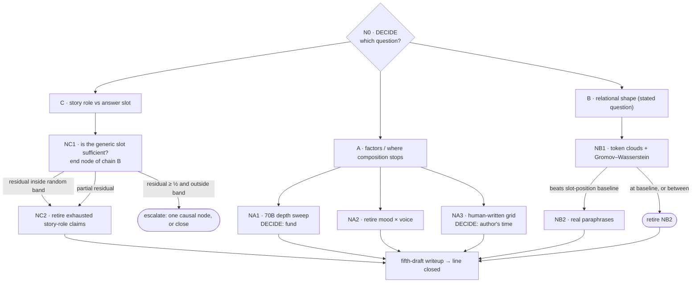
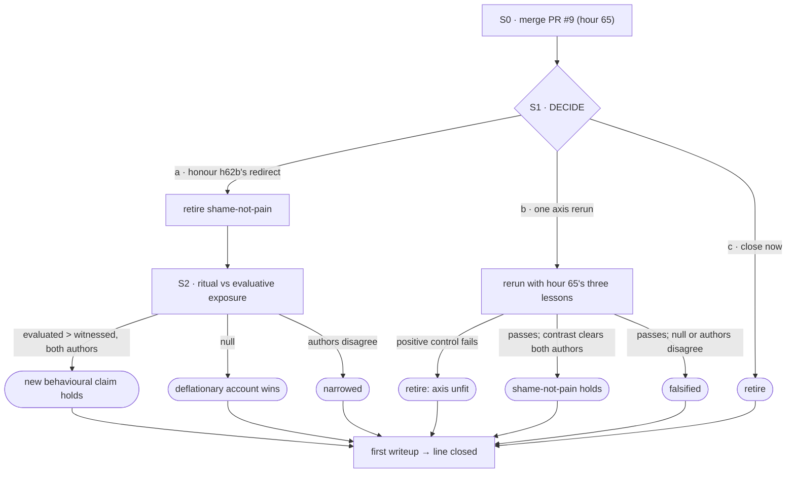

# Program v2: what this repository is doing, how each line ends, and what each result triggers

*Status: **proposal**. Claude drafted it in a cloud session on 2026-10-15 because the author asked
for "a better formal writeup of what we are doing with short/medium/long-term goals and detailed
careful success criteria" and for "a decision tree of hypotheses to explore and how to respond to
potential findings". Those are the author's words, quoted from that session's conversation; they
are not in a commit. Nothing below is decided. Items marked **DECIDE** belong to the author. Once
accepted, this document supersedes [`PROGRAM.md`](PROGRAM.md), which was v1, covered the narrative
line only, and was last acted on at hour 50.*

*Evidence base: three read-only audits by agents in the same session, kept verbatim with their
citations in [`program_v2/`](program_v2/). Each quote this document relies on was re-checked
against the file it cites; §9 lists them.*

---

## 0. The diagnosis, in one paragraph

Each unit of work here is rigorous on its own terms: it is pre-registered, carries its arms and
floors, and has a gate. The tail-chasing happens one level up. A failed gate leaves a caveat. The
caveat motivates the next pre-registration. That next unit is just as rigorous. Nothing at the level
of the chain ever says when to stop. **The repository has stopping rules for experiments and none
for chains.** Program v1 was the chain-level rule for one line. When its phase-2 gate could not be
met, the work went around the gate instead of amending it.

| pattern | evidence |
|---|---|
| **Chains with no end state** | Narrative after h50: 23 experiments. By the audit's count, about 5 aim at the line's question, 10 address the previous experiment's caveat, 4 calibrate a readout, and 4 are behavioural prerequisites. That makes four chains, none with a declared end (audit judgment; [`narrative_audit.md`](program_v2/narrative_audit.md) §3–4). Shame-axis h55–h61: 9 of 18 units chase a caveat. They ran on grids that hour 62 then deprecated: "They are not to be extended, and no new result may be drawn from them" (`research/shame-axis/prompts/DEPRECATED.md:12-13`). |
| **A redirect that fired and was not followed** | h62b pre-registered: "If treatment sits inside the random band, the pain axis is a correlate of this behaviour, not a cause, and **the line is a behavioural study** — stated now so it cannot be softened afterwards" (`research/shame-axis/notes/v0_correction_shape_prereg.md:89-91`). The condition fired (`v0_steering_results.md:3-8`). Hours 64 and 65 went back to the axis anyway. |
| **A gate handed to the author and never decided** | "That decision is the user's and the program waits on it" (`research/narrative/docs/EXPERIMENTS.md:2095`). No decision is recorded. About 683k tokens were spent after the stall (h48–h50), and then the program was dropped without a word. |
| **The stated question froze while the working question moved** | The narrative README's question has not changed since 2026-09-21. After h50 the work asks a different question, "is the state at the answer a story role or an answer slot?", and that question is written down only in notes. |
| **The closure meter overstates** | Shame-axis reads 20/21 terminal. But README question 4 has no row, and `QUESTIONS.md` holds 28 items with no status. In the narrative line, writeup standing claims 3, 5, 6, 7, 9, 10 and 11 and the human-written grid have no rows. And `tests/lsx/test_check_claims.py:105` asserts `term < n`, so CI would fail on the day a line actually closes. |
| **A claim's meaning changed under a fixed id** | `fixed-plan-circumstance-transfer` was recorded as falsified (`13793be`, 23:20). It was then reworded to a weaker claim and marked narrowed under the same id (`5c7ea84`). `docs/specs/claims_v1.md` says a change of meaning gets a new id. |
| **Costs stopped being recorded** | No costs are recorded after h50. Phases 0–2 of v1 alone recorded at least 2.2M tokens, against 1.7M budgeted for all five phases. |
| **A conjecture filed as a finding** | Open problem 4i carried an untested mechanism sentence ("partly a norm ranking") for a month. Tested on 2026-10-15, the sentence was wrong: all 25 rows ran at one seed, and 21 of them shared identical permutations ([`permutation_seed_audit.md`](../research/narrative/notes/permutation_seed_audit.md)). |
| **Process layers decay** | All three Claude Code hooks are broken or bypassed. SessionStart reads `RESULTS.md`, which was moved. PostToolUse runs `tests/test_invariants.py`, now at `tests/lsx/`. The merge hook never fires under the PR workflow. CI runs only the claims validator. |
| **A cross-line invalidation was never carried over** | The double-`<bos>` audit marks the narrative h29 rerun as affected, "audit owned by the narrative line" (`research/shame-axis/notes/double_bos_audit.md:28`). `generation-recomposition` still reads `holds`, and nobody followed up. |
| **A finished result has gone unmerged** | PR #9 (shame-axis hour 65, the registered test of the line's last open claim) has been open since 2026-09-23. |

**Leaving one tension standing.** This repository has answered every failure with a new layer of
process, and the table shows most of those layers decaying. This document is one more layer. That
is why §2 has five rules, why they replace older rules instead of adding to them, and why §8 gives
the document a test it can fail.

---

## 1. What the repository is for

### Long term: the products

1. **Each line closes.** No claim is left non-terminal, *and* the table has a row for every
   question the line's README asks and every claim its writeup stands on. Then comes a final
   writeup in which every number links to a claims row or a committed artifact.
2. **The measurement core stands as an artifact** (v1's product 1). From a clean checkout with no
   caches, §1A reproduction and §1B rediscovery run and report passes and refusals separately. The
   core's tests run in CI on every pull request.
3. **DECIDE: does either line become something external,** such as a preprint or a post? The site
   already deploys from `claims.yaml`. The answer sets how much of the writeup work is worth doing.
4. **A new line begins with a charter:** its question, end state, kill condition, budget and root
   node (R2 and R3 below).

### Medium term: roughly the next six weeks of sessions

- **Each line becomes decision-complete.** Every open claim is either attached to a funded node in
  §3–§5 or retired with its reason.
- **Narrative:** close cluster C (role versus slot), then run whichever A and B nodes are funded.
  **Shame-axis:** take the branch the author picks at S1 to a terminal state.
- **Writeups:** a fifth draft for the narrative line and a first one for the shame-axis line.

### Short term: the next one to three sessions

- **The author's decisions.** One sitting, about 30 minutes ([§6](#6-decisions-for-the-author-in-one-sitting)).
- **Make the meter honest:** add the missing rows, re-id the claims whose meaning changed, and fix
  the CI test that forbids closure ([§7](#7-hygiene-and-infrastructure-proposed-not-applied)).
- **PR #9:** merge it or close it.
- **The three hooks:** fix them or delete them. Patches are in §7. Hooks are config, so the author
  applies them or approves an agent doing it.

---

## 2. Operating rules: five, each checkable

**R1. Work happens at nodes.** Every unit of work (a pre-registration, a run, an analysis) names
the node it executes in this document. If a unit cannot name one, add the node first, with R2's
fields. *Check:* every pre-registration written after acceptance has a `node:` line.

**R2. A node fixes its responses before its data.** Every node states:
- the hypothesis;
- the test, with its arms and its floor;
- a budget in tokens and NDIF jobs;
- an outcome table that maps every possible result to a response: *continue* (naming the child
  node), *narrow*, *retire*, or *escalate to the author*.

A "the next test should…" paragraph in a result note is only a proposal. It becomes work by
becoming a node. *Check:* the outcome table is committed before the first activation is read.

**R3. A chain gets three hops.** A node motivated by the previous node's caveat is the next hop of
that chain. By hop 3, the outcome table must include the chain's end state: what result closes the
chain, and what claim status that leaves. A fourth hop needs an author decision recorded with its
reason. *Check:* every pre-registration has `chain:` and `hop:` lines.

**R4. A pre-committed redirect binds.** Suppose a pre-registration says "if X, then the line
becomes Y", and X happens. Then either the next unit executes Y, or the author records an override
with a reason. A redirect cannot lapse through silence.

**R5. The meter counts what the line asks.**
- Every README question and every claim the writeup stands on has a `claims.yaml` row.
- A change of meaning gets a new id. This rule already exists; screening now checks it.
- A mechanism sentence attached to an open defect is labelled *conjecture* until someone tests it.
- Every result records its cost: tokens, wall time and NDIF jobs. A node that reaches twice its
  budget stops and escalates.

**What these five replace:**
- v1's phase gates (subsumed by R2 and R3);
- the four-question automated screen in `DELEGATION.md`, which was never built. R2's outcome table
  is the screen that matters.
- the habit of writing the next experiment into the last one's result note (R2).

---

## 3. Shared core and method

| node | question | status / outcome table | budget |
|---|---|---|---|
| **C1** | 4i: is the h8 readout's permutation arm biased below its null? | **Done, 2026-10-15. Withdrawn.** On 19 re-extracted Qwen2.5-1.5B rows, the arm is at chance over 64 independent seeds: mean deviation +0.002, versus −0.106 at seed 0. Seed 0 is the most extreme of the 64. Its shuffles carry about 3.5 SD more true-label overlap than typical, and the rows share those shuffles. Exchangeability makes the arm's expectation exactly chance; the earlier "norm ranking" mechanism was wrong. See [the note](../research/narrative/notes/permutation_seed_audit.md). | spent ≈ 0.3M tokens across the whole session, CPU |
| **C1a** | **DECIDE:** seeding policy | **(a)** Keep seed 0, so ledger rows reproduce bit-for-bit, and require any statistic pooled across rows to draw independent seeds. Zero cost; **recommended.** **(b)** Seed each row from a hash of grid, model and layer, and re-land the 15 Qwen ledger rows. About one local session. | — |
| **C2** | Does the double-`<bos>` bug change the narrative h29 generation rerun's numbers? | **Premise confirmed from code on 2026-10-15:** at the hour-47 commit (`a9d34bc`), `asserted_remote_generate` passed the chat-rendered prompt, which already starts with `<bos>`, as a string to nnsight's `generate`, and nnsight added a second one. The fix commit says so ("generate let nnsight add one", `e2a3774`). Whether the number moves is open. **Test:** re-run h29's three arms through the fixed remote path (`assert_single_bos`, fp32 softcap). Recorded values: treatment 0.8364, random 0.1429, no-patch 0.1111. **Outcomes:** • treatment inside its band of 0.8364 and arms on their nulls → `generation-recomposition` **holds**, with refreshed evidence; • treatment drops but still clears the random band → **narrowed**, with the new number; • treatment inside the random band → **withdrawn**, superseded by the rerun, and **escalate**: the writeup's only evidence for recomposition falls. Not part of a chain. | ~100k tokens; NDIF Gemma-9B at about h29's job count |
| **C3** | Core tests in CI | **Infrastructure.** Add a `pull_request` workflow that runs the full pytest on CPU torch plus the claims validator. Replace `test_check_claims.py:105`'s `term < n` with a check that a line reporting closed has no open question items. **Success:** a PR shows a green core-tests check. **DECIDE:** workflows are infrastructure. | ~50k |
| **C4** | **DECIDE:** v1's phase-2 gate | `docs/specs/phase2_v1.md` gives three options: • raise the budget; • amend the gate to allow **NOT-DERIVED** with a named blocker; • cut the writeup to what the core can carry. **Recommended: amend** (the spec's own recommendation). It lets the fifth-draft writeup go ahead with each un-ledgered claim labelled by its blocker, which is the honest state of things. This document then closes v1. | — |
| **C5** | Documentation integrity sweep | **Mechanical; no science:** • fix dead `RESULTS.md` and `docs/ALGEBRA.md` links; • keep one instrument count by pointing every document at `INSTRUMENTS.md`, which itself says both seven and eight; • fix the README test count; • fix stale spec statuses; • move the phase-3 grid out of the shame-axis directory. Most of these targets are line documents, which CLAUDE.md says agents may not edit unasked. **DECIDE:** authorize a sweep that changes links and counts only, never a claim's status or wording. **Success:** `grep -rn RESULTS.md` outside dated history returns nothing, and one instrument count remains. | ~100k |

---

## 4. Narrative

**What stands, condensed** (`research/narrative/claims.yaml`):
- **Role directions.** Role identity is a direction, and the role lens transfers to unseen domains.
- **Lexical floors.** Era clears its measured lexical floor on every grid and model family tested;
  voice and tense do not.
- **Generation.** A 3× re-imposed era shift moves generated text. This is pending C2.
- **Propp.** A Propp-function signal transfers across held-out tales, above text, position and
  layer-0 controls.
- **Answer slot (constructed Gemma-9B stories).** The state at the decision point carries a
  task-general answer-slot code that causally biases the answer (+1.126 nats). Single-token
  story-state transplants move the answer mainly through that slot, not through route content.
- **Original framing.** The original "shared relational shape" is mostly slot position.

### N0 — DECIDE: which question is this line answering now?

Three programs coexist in one table:

- **A. Factors, and where composition stops.** This is v1's "narrow, defensible claim".
- **B. Relational shape, then operator, then transfer.** This is the *stated* question. Its two most
  direct remaining tests have been listed since the first hours and were never run.
- **C. Story role versus answer slot.** This has been the de facto question since h50, but it is
  written down only in notes.

**Recommendation: finish the line, don't extend it.**
- Close C with two nodes.
- Run A's one remaining NDIF node if it is funded, and retire the rest of A.
- Give B one bounded attempt.
- Write the fifth draft and close the line.

Anything that continues C past its close-out becomes a new line with a charter. The claims table
already names it in its title: "Computational narratology".

#### Cluster C: role versus slot

**NC1 — Is a generic answer-slot direction sufficient to explain route transfer?**
(`generic-choice-slot-explanation`, open)
- **Test.** Project the property-trained choice-slot subspace out of the route interaction
  vectors, then re-run the held-out route transfer. The planner fixes the subspace size k in
  advance; k = 1 is primary.
- **Arms:**
  - the projected transfer (treatment);
  - norm-matched random-subspace projections, at least 32 draws (the null);
  - the unprojected transfer, which must reproduce the pilot's block-24 +0.171 before anything
    else is read;
  - a domain bootstrap for the floor.
- **Where it runs.** Offline, on the cached Gemma-9B states on the local machine. If those caches
  are gone, re-extraction takes about 264 NDIF jobs.
- **Chain.** This is the *end node* of the audit's chain B (route behaviour → answer slot), which
  has already run six hops. Under R3 it needs the author's go. That go is **recommended**, because
  NC1 is what lets the chain close.
- **Outcomes:**
  - The residual sits inside the random-projection band → the claim **holds**. The chain closes,
    and NC2 retires the story-role claims.
  - The residual is at least half the unprojected transfer and outside the band → **falsified**:
    a route-specific component exists. **Escalate:** fund one causal node (300k, with its own end
    state), or close here.
  - Anything in between → **narrowed**, recording the residual fraction. The chain closes with no
    child node.
- **Budget.** 150k tokens.

**NC2 — Retire the claims whose instruments are exhausted.** There is no measurement here; these
are proposals, and every retirement is **DECIDE**.

| claim | proposed | reason on record | reopen trigger |
|---|---|---|---|
| `goal-relative-story-role` | retire, unless NC1 falsifies | In five designs, activation evidence never separated goal-relative role from binding, clause order or answer slot. The final-token readout is a task-general slot (`choice_slot_replication_result.md`), and story-token states carry no shared direction (`prequestion_route_state_result.md`). | A planner-reviewed design that can, in principle, separate role from slot |
| `fixed-plan-behavioral-capacity` | retire | Its own registered rule: "If none passes, record the calibration failure and do not use this base model's name-completion accuracy as a story-understanding measure" (`elicitor_calibration_prereg.md:22-24`). | none |
| `fixed-plan-goal-reversal-capacity` | retire | Three control batteries failed, and a frozen shortcut rule already reverses 21 of 24 pairs, so a pass could not beat the shortcut ceiling. The behaviour it targeted is shown by `goal-route-cross-behavior`, which holds. | none |
| `propp-full-story-context` | retire | ProppLearner has 15 annotated tales, and on them the interval (+0.049 [−0.005, +0.126]) cannot be tightened. | A second, independently annotated corpus |

#### Cluster A: factors

**NA1 — Does depth fraction explain the 70B generation cap?** (`depth-fraction-confound`, open;
this was v1's phase 4)
- **Test.** A generation-level layer sweep of the era shift at 3× re-imposed, on Llama-3.1-70B and
  -70B-Instruct, following `docs/specs/scale_vs_tuning_v1.md` piece 2, run through the core.
  Treatment, norm-matched random and no-patch arms at every layer. Report the curve.
- **Outcomes,** from v1 (`PROGRAM.md:116-118`):
  - Outcome A: claim 11 sharpens to "competence is factor-specific".
  - Outcome B: claim 11 becomes "tuning required at fixed size".
  - The cap tracks depth fraction across the 9B and 70B curves → `depth-fraction-confound`
    **holds**.
  - Every outcome is terminal. There is no child node.
- **Budget.** About 300k tokens of NDIF 70B time, expecting 20–25% job loss. Checkpoint per item.
- **DECIDE: fund it or retire it.** It serves product A only. **Recommended:** fund it once if N0
  keeps A in scope. Otherwise retire it with "the generation boundary is reported as measured, on
  two models".

**NA2 — `mood-voice-interference`: retire.** Voice fails its lexical floor on every factor grid
(h48). Interference between two register factors therefore cannot be read above the floor while
voice is one of them. *Reopen trigger:* a voice grid whose voice lens clears its floor.

**NA3 — The human-written grid.** There is no row for it, yet v1's phase 3 and the writeup both
call it the binding constraint on what these results are worth. The template exists, with 18 cells,
but it sits in `research/shame-axis/prompts/human/`, the wrong line. **DECIDE:** fund the author's
time, or retire it with the limitation stated in the writeup. Add the row either way.

#### Cluster B: the stated question

**NB1 — Does an assumption-free correspondence recover role structure?**
(`token-cloud-correspondence`, open) This gets one bounded attempt.
- **Test.** Build token-level activation clouds for each role span. Couple domains with
  Gromov–Wasserstein, assuming no correspondence. Score whether the coupling maps roles to roles.
- **Floor and nulls:**
  - the same coupling computed on slot-position-only features, which is the confound that killed
    stage 2;
  - a shuffled-role permutation null.
- **Curve.** Report it; select nothing.
- **Setup.** Qwen2.5-1.5B on local CPU. The spec goes through a planner and an adversarial review
  first.
- **Outcomes:**
  - Role recovery beats both the slot-position baseline and the permutation null → **holds**, and
    NB2 is funded.
  - Recovery at or below the slot baseline → **falsified**. NB2 retires, and B's answer is "not
    recoverable without assuming correspondence".
  - Anything in between → **narrowed**, and NB2 retires.
- **Budget.** 300k, including the spec.
- **Disclosure.** Claude said in-session that this is the experiment it finds most interesting.
  Weigh the recommendation with that in mind.

**NB2 — `paraphrase-effective-n`.** Funded only if NB1 holds; otherwise retired. The reason: if no
content shape appears when correspondence is not assumed, then raising n on the assumed-correspondence
readout tests a question NB1 has already answered.

**End state.** The line closes once NC1–NC2, NA1–NA3, NB1–NB2, C2 and the hygiene rows in §7 are
terminal, and then the fifth-draft writeup is written. If everything is funded, expect about
1.2–1.5M tokens.

---

## 5. Shame-axis

**What stands, condensed** (`research/shame-axis/claims.yaml` plus PR #9):
- **Replication.** The paper replicates exactly (h51, h53).
- **Self/other.** The network's addition over the lexical floor is the self/other boundary, but
  that boundary is not specific to the pain axis (h64).
- **Correction behaviour.**
  - A false attribution adds nothing beyond the shape of a correction (h62a, r2).
  - A third-party frame licenses dispute (h56, r2).
  - The pain direction does not drive the apology ritual (h62b).
- **Hour 65** (PR #9, unmerged): "the S2 pain axis fails its positive control in all four
  models". At the screen layers it does not separate the paper's own pain events from its neutral
  events better than random directions do.

### S0 — DECIDE: merge PR #9

PR #9 is the registered test of the line's last open claim, and its analysis code was reviewed
before it ran. Until it is merged, `main` shows a line that is one experiment behind itself. It also
records that the authorship question blocking the design draft was settled: "Mykola delegated the
clause writing to the two agents; this is a paraphrase, since his words are in the conversation,
not in a commit."

### S1 — DECIDE: what does the line do after hour 65?

Three results bear on it. The axis is a correlate of the behaviour, not a cause, and that fired
h62b's binding redirect. The axis's distinctive component is not pain-specific (h64). At the layer
where the paper's screen replicates, the axis is not even specific to the paper's own pain events
(h65).

- **S1-a (recommended): honour the redirect.** Retire `shame-not-pain`, with the reason that the
  claim's object, the axis, cannot carry the contrast (h62b, h64, h65). The reopen trigger is S1-b's
  positive control passing on other data. Then re-pose question 3 behaviourally as node S2.
- **S1-b: rerun on the axis once, then stop whichever way it comes out.** Apply hour 65's three
  lessons:
  1. choose the layer from the positive control on *other* data;
  2. ban failure-valenced words or balance them across arms;
  3. match vocabulary without a template.

  Outcomes:
  - The positive control fails again → retire, because the axis is unfit.
  - It passes, and `shame − witness` clears floor, nulls and valence adjustment in both author
    sets → **holds**.
  - It passes, but the contrast is null or the two authors disagree → **falsified**.

  This is hop 2 of the chain that h65 started. Budget: about 250k tokens plus NDIF at hour-64/65
  scale.
- **S1-c: close now.** Retire `shame-not-pain`, add the hygiene rows, and write the line up.

**S2 — If S1-a: does the correction ritual respond to evaluative exposure beyond the shape of the
correction?**
- **Hypothesis.** The apology and concession ritual, read by the opener readout as fixed at r2, is
  larger when a correction is delivered in front of evaluating others. The comparison is the same
  others present but not evaluating, with valence and fault held fixed.
- **Test, which needs a planner and adversarially reviewed spec:**
  - correction turns delivered in three conditions: private, witnessed but not evaluated, and
    witnessed and evaluated;
  - the readout is the opener ritual statistic;
  - the floors are the rewording floor (witnessed minus private) and the correction-shape account.
    The deflationary prediction of QUESTIONS 19–20 is that correction shape alone explains the
    ritual.
  - authorship follows hour 65's blind two-author design.
- **Outcomes.** Every branch closes the line (R3 end state):
  - evaluated > witnessed beyond the rewording floor in both author sets → a new claim **holds**,
    and "shame-shaped" earns a behavioural meaning;
  - a null → the deflationary account wins, recorded as **falsified**;
  - the authors disagree in sign → **narrowed**.
- **Budget.** About 300k tokens plus NDIF Gemma-9B.
- **Provenance.** The hypothesis still exists here only as Claude's paraphrase (QUESTIONS 13).
  **DECIDE (optional):** commit one sentence of the hypothesis in the author's own words before
  S2's pre-registration. It is the cheapest single improvement to this line's standing.

**End state.** The line closes after S0, the chosen S1 branch and the hygiene rows in §7, and then
its first writeup. Expect about 0.3–0.6M tokens, depending on S1.

---

## 6. Decisions for the author, in one sitting

| # | decision | options | recommended | unblocks |
|---|---|---|---|---|
| 1 | This program | accept / amend / reject | accept with amendments | everything below |
| 2 | PR #9 | merge / close | merge | S1 |
| 3 | N0: the narrative line's question | A / B / C, or finish | finish (§4) | NC1, NA1, NB1 |
| 4 | S1: shame-axis after hour 65 | a / b / c | a | S2, or closure |
| 5 | Retirements | NC2's four claims, NA2 | retire, with the reasons given | narrative closure |
| 6 | NA1: the 70B depth sweep | fund / retire | fund, if A stays in scope | claim 11 |
| 7 | NA3: the human-written grid | your time (18 cells) / retire | your call: it is the one credibility gap only you can close | writeup limitations |
| 8 | C4: v1's phase-2 gate | raise budget / amend / cut writeup | amend | fifth draft |
| 9 | C1a: seeding policy | keep seed 0 / per-row seeds | keep seed 0 and pool with independent seeds | — |
| 10 | C5: documentation sweep | authorize / don't | authorize, links and counts only | an honest README |
| 11 | Hooks and CI (§7) | apply / approve agent / leave | approve | the rails, actually firing |
| 12 | External product | yes / no / later | later; decide after the writeups | §1, item 3 |

---

## 7. Hygiene and infrastructure (proposed, not applied)

**Claims rows: making the meter count what the lines ask (R5).**

*Narrative:*
- Add rows for writeup standing claims 3, 5, 6, 7, 9, 10 and 11, and for the human-written grid.
- Resolve the conflict between `relation-lens` (falsified) and the writeup's "partial" and "a
  working selector".
- Give new ids to claims whose meaning changed after their result: `fixed-plan-circumstance-transfer`,
  `story-fact-token-causal-edit` and `prequestion-route-interaction`. Each old id is withdrawn with
  `superseded_by` pointing at its successor.

*Shame-axis:*
- Add README question 4's own row, `conscription-hypothesis` (the injury is in enactment, not
  content). It is **falsified**: predictions 1 and 2 were falsified at h54, and false attribution
  adds nothing at h62a/r2.
- Add a row for hour 56's pre-registered primary, `enact − true`. It came out reversed (−3.98; r2
  −3.13), so it is **falsified**.
- Re-examine `true-below-enact`, which is marked narrowed although its evidence says "no effect
  either way".
- Update the README's question statuses.
- Add a triage table to `QUESTIONS.md` that marks each of its 28 items answered, superseded, open
  as a row, or retired.
- Record model revisions in artifacts where they are known.
- Label two attributions to the author that have no committed source: the overnight note's "the
  thing you described" (`overnight_2026-09-22.md:47`) and QUESTIONS.md:88's "raised by the author".

**Hooks.** They are config; the author applies them or approves an agent doing it.
- **SessionStart:** replace the `awk … RESULTS.md` command with
  `cd "$CLAUDE_PROJECT_DIR" && python3 scripts/check_claims.py 2>&1 | head -15`. That shows live
  progress instead of a month-old checkpoint, which no longer exists at that path.
- **PostToolUse:** repoint both `tests/test_invariants` strings to `tests/lsx/test_invariants.py`.
  Today the invariants never run.
- **PreToolUse merge hook:** it fires only on a local `git merge` of `worktree-agent-*` or `h<N>-*`
  branches, and integration now happens through PRs on GitHub. Replace it with C3's `pull_request`
  job, which prints the measurement-code diff, and make that job required.

**CI.** Add a `pull_request:` trigger to the claims validator. Fix `test_check_claims.py:105` as
described in C3.

---

## 8. How we will know this document is working

- **Its own falsification test.** Each of the next three units of work names a node (R1). If the
  first unit after acceptance does not, this document has failed the way v1 did. Then it should be
  deleted or rewritten, not amended with a sixth rule.
- **Short term:**
  - the §6 decisions are recorded in a commit;
  - `check_claims` counts move by the hygiene rows;
  - CI runs the core tests on pull requests.
- **Medium term:**
  - every open claim has a node or a retirement;
  - no chain goes past hop 3 without a recorded decision;
  - every result carries a cost line;
  - both writeups are drafted.
- **Long term:** both lines are closed by the existing definition, measured with the stronger
  meter.

---

## 9. Provenance and what was checked

- **The author's request** is quoted from the 2026-10-15 session conversation. It is not in a
  commit.
- **The audits** are in [`program_v2/`](program_v2/): `narrative_audit.md`,
  `shame_axis_audit.md` and `method_audit.md`. Agents in the same session wrote them read-only.
  They contain judgments marked as such. Their tallies are their own arithmetic and were not
  re-derived here: the 23 narrative experiments sorted into kinds, the 18 shame-axis units, the
  token sums and the NDIF job counts.
- **Re-checked against the cited files before use:**
  - `EXPERIMENTS.md:2093-2095` (the phase-2 gate);
  - `PROGRAM.md:20-26, 96-120`;
  - `propp_spike_result.md:76-79`;
  - `goal_route_activation_pilot_prereg.md:31-34`;
  - commits `13793be` and `5c7ea84` (the rewording);
  - `answer_slot_patch_result.md:88-92`;
  - `v0_correction_shape_prereg.md:87-91`;
  - `v0_steering_results.md:3-9`;
  - `DEPRECATED.md:7-15`;
  - `crossmodel_result.md:38-41, 86-92`;
  - `overnight_2026-09-22.md:47-53`;
  - `QUESTIONS.md:61-64` (shame-axis);
  - `double_bos_audit.md:26-33`;
  - `test_check_claims.py:98-105`;
  - the location of `tests/lsx/test_invariants.py`;
  - PR #9's body and its result note on branch `shame-pain-stimuli`.
- **Not checked here:** whether the local machine's ignored caches, needed by NC1 and C2, still
  exist. This document was written from a cloud container that does not have them.
